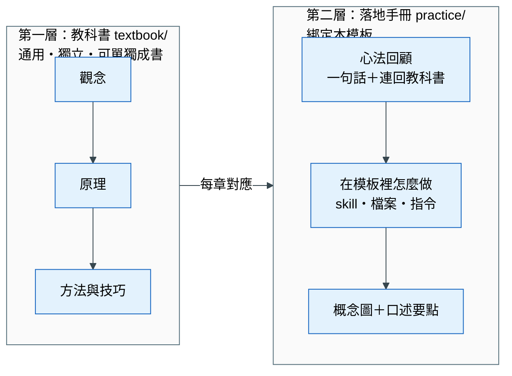

# docs/ — 教材（兩層：觀念 → 落地）

> 上課順序：**先講觀念（教科書）→ 再講技巧 → 最後用實戰專案把心法套進來（落地手冊）。**
> 兩層解耦：教科書不提任何工具、資料夾或 skill；落地手冊不重講理論，只連回教科書的章節。

## 兩層的分工

| | 第一層：教科書 `textbook/` | 第二層：落地手冊 `practice/` |
|---|---|---|
| 定位 | 工程落地導向的大學教科書 | 實戰專案的操作與講解手冊 |
| 讀者 | 任何學資料科學的人 | 使用本模板的學員與講師 |
| 內容 | 定義、原理、方法、判斷準則、通用案例、習題 | 心法 → 模板對應 → 指令 → 檢核；講師口述要點 |
| 不放 | skill、資料夾、hook、特定資料集 | 理論推導（只連回教科書） |
| 形式 | 列點為主、每章一張主視覺 | 以概念圖為主、文字是講師提示 |
| 可以單獨使用嗎 | ✓（換任何專案或工具都成立） | ✗（需搭配本模板） |

## 章節對應

| 教科書 | 落地手冊 |
|---|---|
| [00 先備知識](textbook/00_prerequisites.md) | [00 總覽：pipeline 與資料夾](practice/00_overview.md) |
| [01 問題分析與拆解](textbook/01_problem_framing.md) | [01 定邊界](practice/01_define_boundaries.md) |
| [02 探索式資料分析](textbook/02_eda.md) | [02 資料理解與假設驗證](practice/02_data_and_eda.md) |
| [03 資料切分與洩漏](textbook/03_split_and_leakage.md) | [03 驗證規則與防洩漏機制](practice/03_validation_guardrails.md) |
| [04 特徵工程](textbook/04_feature_engineering.md) | [04 特徵從原型到上線](practice/04_feature_lifecycle.md) |
| [05 模型選擇與評估](textbook/05_model_selection.md) | [05 實驗紀錄與模型比較](practice/05_experiments.md) |
| [06 人機協作的資料科學](textbook/06_human_ai_collaboration.md) | [06 每輪審查與交付](practice/06_review_and_delivery.md) |

## 規則

- 教科書裡出現工具名稱，只限通用函式庫（pandas、scikit-learn、LightGBM 等），不提本模板的任何元件
- 圖一律用 Mermaid 寫在 Markdown 裡；插圖放 `docs/assets/`
- 建議用 MkDocs Material 發佈成網站，兩層各一個側欄分頁

## 寫作規範（兩層都適用）

讀者是**初學者**。他不缺結論，缺的是「為什麼」。只給結論，他只能背；理解了為什麼，他才能在新問題上自己推出做法。

1. **先問題，後方法**：每一節依「遇到什麼麻煩 → 不處理會怎樣（具體例子）→ 所以我們這樣做 → 怎麼做 → 常見錯誤」的順序寫。不可以一開頭就給規則。
2. **術語第一次出現就用白話解釋**：格式是「中文名稱（英文）＝ 一句白話 ＋ 一個生活例子」。全書統一的解釋收在 [`textbook/glossary.md`](textbook/glossary.md)。縮寫（T0、CV、PR-AUC）第一次出現必須寫全名。
3. **用段落敘述，表格輔助**：像寫一份 Word 教材。一個觀念先用 1–3 段文字講清楚，再用表格整理比較。不要整章都是條列。
4. **每張圖都有前言和讀法**：
   - 圖之前：「這張圖要回答什麼問題、為什麼需要它」
   - 圖之後：「怎麼讀這張圖」：從哪裡看起、箭頭代表什麼、要記住哪一點
   - 一張圖最多 7 個方塊；超過就拆成兩張，或改用表格
5. **每個規則都附理由**：寫「要這樣做」時，同一段要寫「因為不這樣做會發生 ___」。
6. **用一個貫穿的例子**：同一章盡量沿用同一個情境，讓讀者不用一直切換脈絡。
