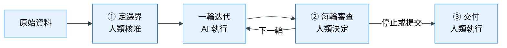
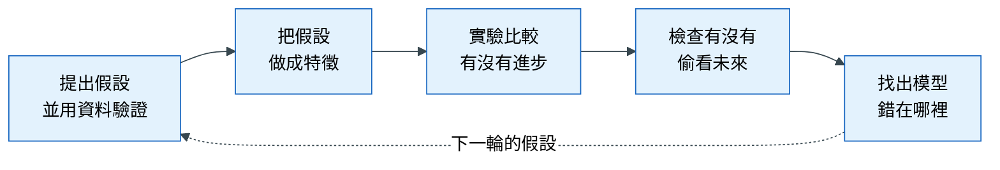
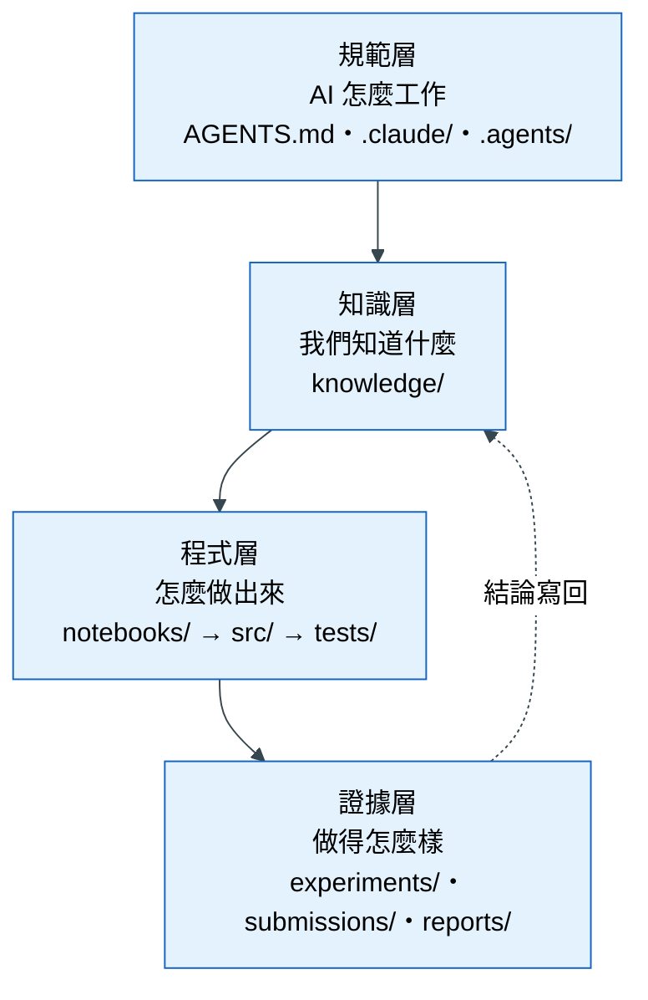

# 落地 0｜總覽：整個流程、資料夾與 AI 助手

## 這一章要解決什麼問題

想像你請了一位非常勤快的助理：他一小時可以寫一百段程式、畫五十張圖、跑二十次實驗，而且從不抱怨。聽起來很理想，但很快你會發現一個麻煩：他交回來的結果**看起來都很合理**。程式能跑，圖很漂亮，分數也越來越高。可是其中有一些結論是錯的，例如他不小心用了「未來才會知道的資訊」，或者只是剛好在某一個月份表現比較好。這些錯誤不會讓程式當掉，所以你很難發現。

這就是 AI 時代做資料科學的處境。AI 讓「做實驗」變得非常便宜，但沒有讓「判斷實驗是否可信」變得更容易。如果沒有一套規則，AI 產出的錯誤結論會比以前更多、更快、更難察覺。

所以這個模板的核心想法是一句話：

> **人類定邊界、做去留決定；AI 負責執行、記錄，並主動質疑自己的結果。**

這一章先說明模板裡會用到的幾個名詞，再介紹整個流程，最後介紹資料夾的用途。

## 心法回顧

教科書第 6 章談過：AI 改變的是成本結構。寫程式和跑實驗變便宜了，但「定義問題」和「判斷證據」沒有變便宜，這兩件事仍然是人類的責任。這個模板就是把這個分工落實成具體的規則與檔案。（教科書 [00 先備知識](../textbook/00_prerequisites.md)、[06 人機協作的資料科學](../textbook/06_human_ai_collaboration.md)）

## 先認識五個名詞

在開始之前，先用白話說明模板裡會反覆出現的五個名詞。它們都是「讓 AI 遵守規則」的不同手段。

| 名詞 | 白話解釋 | 生活比喻 | 為什麼需要它 |
|---|---|---|---|
| **AI 助手**（Claude Code、Codex） | 在終端機裡和你對話、可以讀寫檔案和執行程式的 AI | 一位會寫程式的助理 | 實際執行分析工作的那個人 |
| **AGENTS.md** | 放在專案最上層的一份規則文件，AI 每次開始工作都會先讀 | 新進員工的工作守則 | 讓 AI 知道這個專案的鐵律，例如「不能讀最終答案」 |
| **Skill**（技能） | 一份寫好的「標準作業程序」，告訴 AI 某一類工作的步驟與驗收標準 | 一張料理食譜 | 讓同一類工作每次都用同樣的品質完成，不靠 AI 臨場發揮 |
| **Subagent**（子代理） | 一個只負責特定角色的 AI 分身，有自己的權限限制 | 公司裡的專責人員，例如稽核員只能看帳、不能改帳 | 把「做事的人」和「檢查的人」分開，避免球員兼裁判 |
| **Hook**（掛鉤）與 **pre-commit** | 在 AI 做某些動作之前或之後，自動執行的檢查程式 | 門禁系統：刷卡沒通過，門就不開 | 規則寫在文件裡，AI 可能忘記；寫成自動檢查，它就躲不掉 |

這五樣東西的關係可以這樣理解：AGENTS.md 告訴 AI「應該怎麼做」，skill 告訴它「某件事的步驟」，subagent 讓不同角色互相制衡，hook 和 pre-commit 則在 AI 犯規時直接擋下來。

## 整個流程長什麼樣子

### 為什麼需要這張圖

一個資料科學專案很容易變成「一直做、一直調」，最後說不清楚自己做了什麼、何時該停。所以模板把專案切成固定的幾個階段，並在其中設下三道**人類閘門**：到了這些點，AI 必須停下來，由人類做決定。

### 怎麼讀這張圖

從左往右看。標著 ①②③ 的方塊是人類閘門，中間的「一輪迭代」是 AI 主要工作的地方。

- **① 定邊界**：開始分析之前，人類先決定「要預測什麼、在什麼時間點預測、怎樣算成功」。沒有通過這一關，AI 不准開始建模，因為問題定錯了，後面做得再好也沒有用。
- **一輪迭代**：AI 探索資料、提出假設、做特徵、跑實驗。這一段可以重複很多次。
- **② 每輪審查**：每一輪結束，AI 整理證據，由人類決定「要留下哪些結論」以及「下一輪、停止，還是提交」。
- **③ 交付**：人類決定提交後，才拿最終答案評估一次，並寫成報告。

要記住的一點：**三道閘門都由人類決定，AI 只提供證據和建議。**

### 一輪迭代裡面做什麼

上圖把「一輪迭代」畫成一個方塊。打開這個方塊，裡面是下面這個順序：

**怎麼讀這張圖**：這是一個循環。每一輪從一個猜測開始（例如「新客戶比較容易退貨」），用資料驗證後，把它做成模型可以用的特徵，再用實驗確認有沒有進步、有沒有洩漏。最後看模型錯在哪裡，錯誤的地方就是下一輪的新猜測。

## 第一次使用：七個步驟

| 步 | 為什麼要做 | 你做 | 對 AI 說 | 完成的訊號 |
|---|---|---|---|---|
| 0 | 每個專案要有乾淨的版本紀錄 | 複製模板，刪掉舊的 git 紀錄，重新 `git init` | — | 一個新的專案資料夾 |
| 1 | AI 需要知道資料在哪裡、從哪裡來 | 把原始資料放進 `data/raw/`，在 `data/README.md` 登記來源 | — | 來源表多了一列 |
| 2 | 問題必須先定義清楚 | 回答 AI 的提問 | 「用 define-boundaries 幫我定義這個專案」 | `knowledge/brief.md` 填好了 |
| 3 | 邊界必須由人類拍板 | **讀 `brief.md`，同意後把 `status` 改成 `approved`** | — | 第一道閘門通過 |
| 4 | 先認識資料，才不會被資料的坑騙 | 看 AI 整理的資料說明 | 「用 data-card 整理資料，然後開始第一輪 EDA」 | `knowledge/data.md` 寫好了 |
| 5 | 這是 AI 主要工作的階段 | 隨時提問、指定要驗證的猜測 | 「用 hypothesis-eda 驗證『…』」 | `knowledge/log.md` 持續增加 |
| 6 | 每一輪都需要人類決定方向 | 讀摘要，決定留什麼、下一步做什麼 | 「round-review」 | 你做出決定 |

初學者只要記住兩件事：**第 3 步要親自核准**，**每一輪結束時說「round-review」**。其他的事 AI 會依照 AGENTS.md 自動執行。

## 資料夾：每個資料夾為什麼存在

### 為什麼要這麼多資料夾

如果所有檔案都丟在同一個地方，很快就會分不清：哪個是原始資料、哪個是處理過的？哪段程式只是試試看、哪段是正式使用的？哪個分數是哪次實驗跑出來的？資料夾的分層就是為了回答這些問題。而且每個資料夾的 `README.md` 寫明規則，AI 寫入檔案之前會先讀它。

### 四層架構

**怎麼讀這張圖**：由上往下是「規則 → 知識 → 程式 → 證據」。規範層規定 AI 的行為；知識層記錄專案的定義與結論；程式層產生結果；證據層保存每一次的分數與最後的交付。虛線代表證據產生的結論，會寫回知識層，成為下一輪的起點。

### 每個資料夾的用途

| 資料夾 | 為什麼存在 | 放什麼 | 誰可以寫 |
|---|---|---|---|
| `knowledge/` | AI 沒有跨對話的記憶，需要一個地方保存「專案知道什麼」 | 4 份文件：專案定義、資料說明、研究日誌、發現 | 見下表 |
| `data/raw/` | 原始資料一旦被改，就無法重現任何結果 | 原始資料，**唯讀** | 只有人類 |
| `data/interim/`、`data/processed/` | 處理過的資料要和原始資料分開 | 清理、合併後的資料；建模用的資料表 | AI，但必須能用程式重建 |
| `data/holdout/` | 最終答案只能看一次，必須有人保管 | 最後評估用的答案 | **只有人類**，AI 不能讀 |
| `notebooks/` | 探索時需要快速試錯，不必寫得很正式 | 試做用的程式，用完即丟 | AI |
| `src/` | 確定有價值的程式要長期維護、可以重複使用 | 正式的程式碼 | AI，必須附測試 |
| `tests/` | 需要自動檢查程式有沒有偷看未來 | 測試，一定要有洩漏測試 | AI |
| `experiments/` | 每個分數都要能追溯來源 | 實驗紀錄 `log.jsonl`，只追加不修改 | AI |
| `submissions/` | 最終提交要和平常的實驗分開 | 最後交出去的預測檔，只交一份 | 人類決定提交時才產生 |
| `reports/` | 決策者需要看得懂的結論 | 給主管的報告與圖 | AI 撰寫，人類審閱 |

### knowledge/ 的四份文件

`knowledge/` 是人類和 AI 的共同記憶，值得單獨說明。它刻意只有四份文件，因為文件越多，越沒有人會去讀。

| 文件 | 為什麼需要 | 什麼時候寫 | 誰觸發 |
|---|---|---|---|
| `brief.md` 專案定義 | 所有工作都要有共同的起點與邊界 | 開始前，寫一次 | 你說「define-boundaries」 |
| `data.md` 資料說明 | 資料的坑只要踩過一次，就該記下來 | 拿到資料時 | 你說「data-card」 |
| `log.md` 研究日誌 | 失敗的嘗試也有價值，不記下來就會重做 | **AI 每次回報結果時自動追加** | AI 自動 |
| `findings.md` 發現 | 不是每個實驗都值得記住，只留下會改變決定的結論 | 每輪結束 | 你說「round-review」 |

### 一個檔案該放哪裡

| 這是什麼？ | 放在 |
|---|---|
| AI 該遵守的規則 | `AGENTS.md` |
| 專案的定義或結論 | `knowledge/` |
| 原始資料 | `data/raw/` |
| 試試看的程式 | `notebooks/` |
| 會重複使用、影響最終模型的程式 | `src/`，並在 `tests/` 補測試 |
| 一次實驗的分數 | `experiments/log.jsonl` |
| 交出去評分的預測 | `submissions/` |
| 給主管看的內容 | `reports/` |

## Skill 與 subagent 總表

### 什麼是 skill、什麼是 subagent

**Skill** 是一份標準作業程序。當你對 AI 說「用 data-card 整理資料」，AI 會先讀 `data-card` 這份文件，照裡面的步驟做，最後用裡面的標準驗收。這樣做的好處是品質穩定：不管哪一天、哪一個人使用，做出來的東西都符合同樣的標準。

**Subagent** 是一個有特定角色的 AI 分身。這個模板有四個 subagent，各自只能做自己角色範圍內的事。最重要的是 `validation-agent`：它**只能讀、不能改**檔案，任務是試著推翻「模型變好了」這個說法。把「做的人」和「查的人」分開，就像公司裡的會計和稽核分屬不同人。

（subagent 是 Claude Code 才有的功能；使用 Codex 時，AI 會依照 AGENTS.md 的角色表自我約束。）

### 11 個 skill 在哪一章使用

| 階段 | Skill | 一句話用途 | 詳見 |
|---|---|---|---|
| 定邊界 | `define-boundaries` | 訪談人類，寫出專案定義 | 落地 1 |
| 理解資料 | `data-card` | 用實際跑過的程式整理每張表 | 落地 2 |
| 探索 | `hypothesis-eda` | 先寫預期，再用資料驗證猜測 | 落地 2 |
| 特徵 | `feature-card` | 做特徵前先把定義與可得性說清楚 | 落地 4 |
| 特徵 | `leakage-audit` | 檢查特徵有沒有偷看未來 | 落地 3、4 |
| 特徵 | `promote-to-src` | 把有價值的程式升級成正式程式 | 落地 4 |
| 實驗 | `experiment-protocol` | 公平比較並記錄 | 落地 5 |
| 實驗 | `error-analysis` | 找出模型錯在哪裡 | 落地 5 |
| 審查 | `round-review` | 每輪結束，整理證據給人類決定 | 落地 6 |
| 沉澱 | `knowledge-capture` | 自動記錄過程，整理值得留下的結論 | 落地 6 |
| 交付 | `report-writer` | 寫給決策者看的報告 | 落地 6 |

### 四個 subagent

| Subagent | 角色 | 可以做 | 不可以做 |
|---|---|---|---|
| `eda-agent` | 探索分析員 | 探索資料、驗證假設 | 修改 `src/` |
| `feature-agent` | 特徵工程師 | 做特徵、升級進 `src/`、補測試 | 修改驗證規則與指標 |
| `model-agent` | 實驗執行者 | 建模、比較、錯誤分析 | 修改切分方式、用最終答案調整模型 |
| `validation-agent` | 稽核員（唯讀） | 審查洩漏、驗證設計、增益是否可信 | 修改任何檔案 |

## 講師口述要點

- 開場先講「勤快但會犯合理錯誤的助理」這個比喻，讓學員理解為什麼需要規則，再介紹工具
- 五個名詞（AGENTS.md、skill、subagent、hook、pre-commit）都是「讓 AI 守規矩」的手段，強度由弱到強
- 強調三道人類閘門：AI 再強，也不能替你決定問題的邊界與結論的去留
- 資料夾不是為了整齊，是為了回答「這個檔案、這個分數從哪裡來」
- 新手只要記兩件事：親自核准 `brief.md`、每輪說「round-review」

## 檢核清單

- [ ] 能用自己的話說明為什麼 AI 時代需要人類閘門
- [ ] 能說出 AGENTS.md、skill、subagent、hook 各自的用途
- [ ] 能說出三道人類閘門分別在哪裡、由誰決定什麼
- [ ] 知道 `knowledge/` 四份文件各自什麼時候產生
- [ ] 拿到一個檔案時，知道該放在哪個資料夾
