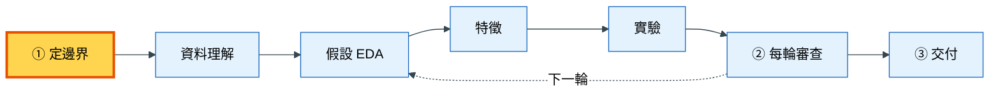
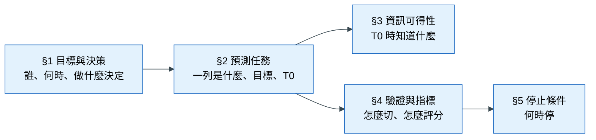
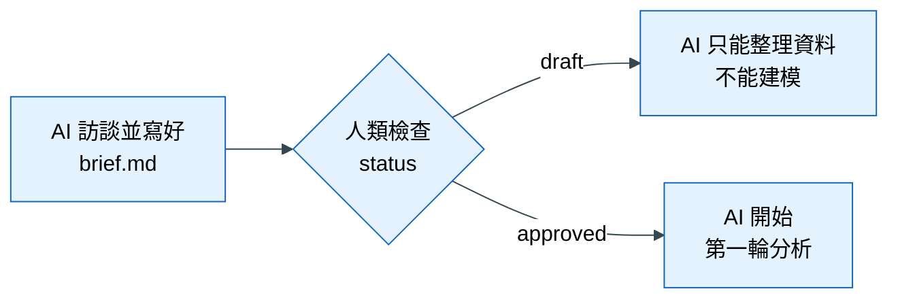

# 落地 1｜定邊界：先決定要解決什麼問題

## 這一章要解決什麼問題

假設主管丟給你一句話：「我們退貨太多了，用資料分析看看。」你和 AI 助手立刻開始工作：AI 讀了所有資料表，做了幾十張圖，訓練出一個模型，準確率 95%。你很高興地拿去報告，主管卻問了三個問題：

1. 「這個模型是要給誰用的？客服？倉庫？還是商品部門？」
2. 「它是在訂單成立的時候預測，還是出貨以後？如果是出貨以後，客服已經來不及處理了。」
3. 「95% 是什麼意思？我們的退貨率本來就只有 5%，全部猜『不會退貨』不就是 95% 了嗎？」

你答不出來。問題不在模型，而在**一開始沒有把問題定義清楚**。這一章要做的，就是在動手之前，把專案的邊界寫成一份文件，並由人類核准。

## 心法回顧

教科書第 1 章的核心是：**預測任務由決策決定，不是由資料決定**。要先問「誰、在什麼時候、要做什麼決定」，才能決定預測時點 T0（我們在哪一刻做預測；T0 之後才發生的事一律不能用）、目標、指標和驗證方式。（教科書 [01 問題分析與拆解](../textbook/01_problem_framing.md)；術語見 [術語表](../textbook/glossary.md)）

## 本章在整個流程的位置

這一章是整個流程的第一步，也是第一道人類閘門：

黃色方塊是本章的位置。後面所有階段都以這一步寫下的文件為依據。

## 步驟

### 步驟 1：讓 AI 訪談你

**為什麼要做這一步**：定義問題需要的資訊，大部分在你（或你的主管）腦中，不在資料裡：誰會用這個預測、他一天能處理幾件、做錯的代價是什麼。AI 不知道這些，如果讓它自己猜，它會填一個「看起來合理」的答案，而你很可能沒仔細看就同意了。所以這個步驟的設計是：**AI 負責問，你負責答**。

**怎麼做**：對 AI 說「用 define-boundaries 幫我定義這個專案」。AI 會一次問一個問題，順序大致如下：

| 順序 | AI 會問 | 為什麼問這個 |
|---|---|---|
| 1 | 這個預測結果，誰會在什麼時候拿來做什麼決定？他一天能處理幾件？ | 決策決定了一切，容量決定了指標要看「前幾名」 |
| 2 | 一列代表什麼？要預測的目標精確來說是什麼？ | 例如「訂單成立後 30 天內是否退貨」，門檻和時間窗要寫清楚 |
| 3 | 決策發生的那一刻是哪個事件？ | 這就是 T0 |
| 4 | 每張表、每個欄位，在 T0 那一刻已經被看到了嗎？ | 這張表是之後檢查洩漏的依據 |
| 5 | 上線時要預測的是未來的事、新的客戶，還是同類型的樣本？ | 決定資料要怎麼切分來驗證 |
| 6 | 用什麼指標判斷好壞？基準是什麼？ | 沒有基準，分數沒有意義 |
| 7 | 做到什麼程度就停？ | 避免無止盡地調整 |

**會產出什麼**：AI 把答案整理到 `knowledge/brief.md`。這份文件之所以放在 `knowledge/`，是因為它是整個專案的共同起點，之後 AI 每次開始工作都會先讀它。

**怎樣算完成**：`brief.md` 的五個區段都有內容；不知道的地方寫「待業務確認」，而不是由 AI 代填。

### 步驟 2：檢查「資訊可得性」表

**為什麼要做這一步**：`brief.md` 的 §3 是一張表，列出每個欄位「什麼時候被觀察到」。這張表是後面所有防洩漏機制的依據：AI 做特徵時要對照它，稽核時也要對照它。如果這張表錯了，例如把「退款金額」標成 T0 可用，後面的檢查全部會跟著錯。

這裡有一個很容易搞錯的地方：要看的是「**被觀察到**的時間」，不是「**發生**的時間」。例如顧客的評價是在收貨後寫的，但系統可能隔幾天才收到。對預測來說，重要的是我們**什麼時候能拿到**這個值。

**怎麼做**：逐列看 §3 的表。對每個欄位問自己：「在 T0 那一刻，我們的系統裡已經有這個值了嗎？」

**怎樣算完成**：每一張原始資料表都出現在這張表裡；有疑問的欄位已經問清楚。

### 步驟 3：親自核准

**為什麼要做這一步**：`brief.md` 定義的是「這個專案要回答什麼問題、怎樣算答對」。這是一個**業務判斷**，不是技術判斷，所以必須由人類負責。如果 AI 可以自己定義問題，它就可以把問題改成自己容易答的版本，例如把指標改成比較好看的那一個。

**怎麼做**：讀完 `brief.md`，同意的話把文件最上方的 `status: draft` 改成 `status: approved`，並填上你的名字和日期。

**會發生什麼**：在 `status` 變成 `approved` 之前，AGENTS.md 規定 AI 只能做定義邊界或整理資料，**不准開始建模**。核准之後，這份文件就只有人類能改；AI 想改的話，必須在 `knowledge/log.md` 寫一段「修改提案」，等你決定。

**怎樣算完成**：`status` 是 `approved`，`approved_by` 有你的名字。

## 概念圖

### 圖一：brief.md 的五個區段

**為什麼需要這張圖**：`brief.md` 有五個區段，初學者常常不知道它們之間的關係，只把它當成一張要填的表。其實這五個區段是一條推理鏈：前一段的答案決定了後一段。

**怎麼讀這張圖**：從左邊的「決策」開始。知道了誰要做什麼決定（§1），才能決定要預測什麼、在哪一刻預測（§2）。有了 T0，才能判斷哪些資訊可以用（§3）；知道上線時要預測什麼，才能決定怎麼驗證（§4）。最後才訂出停止條件（§5）。要記住的是：**一切從決策開始**，如果 §1 寫不出來，後面都不要填。

### 圖二：第一道人類閘門

**為什麼需要這張圖**：學員常問：「AI 都寫好了，為什麼還要我去改一個字？」這張圖說明 `status` 這個欄位擋住了什麼。

**怎麼讀這張圖**：AI 寫好文件後，球在你手上。只要 `status` 還是 `draft`，AI 就停在「整理資料」這一步；你改成 `approved`，它才會往下走。這個設計確保問題的定義永遠是人類拍板的。

## 用到的 skill 與 subagent

| Skill | 它做什麼 | 什麼時候用 | 你要檢查什麼 | 為什麼要檢查這個 |
|---|---|---|---|---|
| `define-boundaries` | 一次問一題，訪談你之後寫出 `brief.md`，並在 `log.md` 記一段「R0 定義邊界」 | 專案第一天；或 `brief.md` 還不是 `approved` 時 | T0 是不是由「決策時點」決定的 | 如果 T0 是依「資料最完整的時間」選的，模型會用到上線時拿不到的資訊 |
| | | | 成本、容量、負責人這類業務問題，是否寫著「待業務確認」而不是被 AI 填了數字 | 這些是業務事實，AI 猜的數字會讓後面的指標和停止條件都失真 |
| | | | §3 是否涵蓋所有原始表 | 漏掉的表，之後就沒有人檢查它的欄位會不會洩漏 |

這個階段不需要 subagent。定義問題是人類與主對話之間的事。

## 講師口述要點

- 用「退貨分析」的情境開場，讓學員親身感受「沒有先定義問題」的後果
- T0 由決策決定：問學員「客服要在什麼時候拿到名單，才來得及處理？」答案就是 T0
- 強調「被觀察到」和「發生」的差別，這是最常見的洩漏來源之一
- `brief.md` 的五個區段是一條推理鏈，不是一張隨便填的表
- 學員最常犯的錯是讓 AI 代填業務數字；提醒他們「不知道就寫不知道」

## 檢核清單

- [ ] `brief.md` 的 §1 寫得出「誰、在什麼時候、做什麼決定、一天能處理幾件」
- [ ] 目標的定義包含門檻與時間窗
- [ ] T0 是由決策時點決定的，並能說出理由
- [ ] §3 涵蓋所有原始表，寫的是「被觀察到的時間」
- [ ] §4 有切分方式、主指標、兩種基準
- [ ] §5 有停止條件
- [ ] `status` 已由人類改成 `approved`
