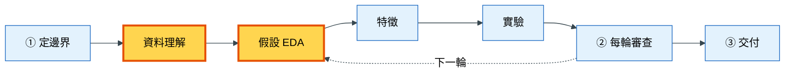
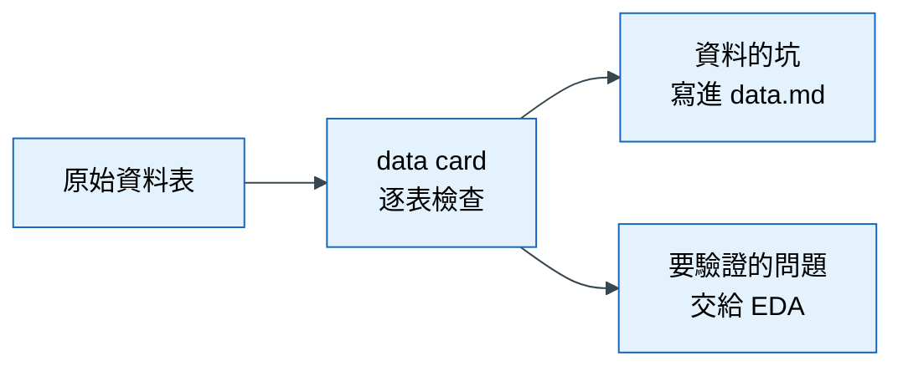
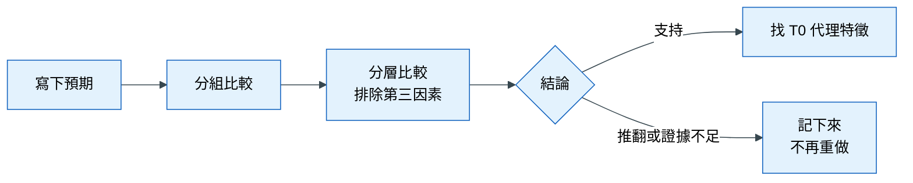

# 落地 2｜資料理解與假設驗證

## 這一章要解決什麼問題

延續上一章的退貨預測專案。邊界定好了，你請 AI「做一下 EDA」。十分鐘後，AI 交回四十張圖：每個欄位的分布、每兩個欄位的相關、各種長條圖和散佈圖。你一張張看下去，覺得每張都有點意思，但看完之後，你並不知道下一步該做什麼。

更糟的是，裡面有一張圖顯示「訂單金額越高，退貨率越高」，你很興奮地把它記下來。後來才發現，這份資料的訂單明細表是「一筆訂單多列」，AI 在合併資料表時沒有先加總，導致多品項訂單的金額被重複計算了好幾次。這張圖的結論根本是錯的。

這個情境暴露了兩個問題：

1. **沒有先認識資料**：不知道每張表「一列代表什麼」，合併時就會出錯。
2. **沒有問題的探索**：沒有先想好要驗證什麼，圖畫得再多也只是在找巧合。

所以這一章分成兩段：先用 data card 認識資料，再用假設卡有目的地驗證猜測。

## 心法回顧

教科書第 2 章說：EDA 是為了**做決定**而減少不確定，不是為了畫圖。要先寫下預期，再跑程式，否則看到什麼都會覺得像證據。另外，兩個欄位一起變化（相關），不代表其中一個造成另一個（因果）；要用**分層比較**檢查是否有第三個因素在背後同時影響兩者。（教科書 [02 探索式資料分析](../textbook/02_eda.md)；術語見 [術語表](../textbook/glossary.md)）

## 本章在整個流程的位置

這一章涵蓋流程中的兩個階段：

「資料理解」只在拿到新資料時做一次；「假設 EDA」則是每一輪都會回來的起點（注意右邊那條「下一輪」的虛線指回這裡）。

## 步驟

### 步驟 1：用 data card 認識每一張表

**為什麼要做這一步**：開頭的例子裡，錯誤來自「不知道訂單明細表是一筆訂單多列」。這類資料的坑如果沒有在一開始找出來，之後會變成錯誤的圖、錯誤的特徵，甚至資料洩漏。Data card 就是一份「資料的身分證」，逐張表回答幾個固定問題，把坑先找出來。

**怎麼做**：對 AI 說「用 data-card 整理資料」。AI 會針對每一張表回答：

| 問題 | 為什麼要問 |
|---|---|
| 一列代表什麼？主鍵是否唯一？ | 搞錯這個，合併時就會重複計算 |
| 和分析單位是一對一還是一對多？ | 一對多的表要先加總，才能合併 |
| 每個欄位的型別、缺失率、在 T0 是否可得？ | 缺失多的欄位要小心；T0 之後才有的欄位不能當特徵 |
| 有沒有奇怪的值？（負數、未來日期、重複） | 奇怪的值常常是資料錯誤，或是某種業務規則 |

這裡有一條特別的規定：**不准模擬**。Data card 上的每個數字都必須來自實際執行過的程式，不能由 AI 憑印象填寫。因為 AI 很容易寫出「看起來合理」的數字，而你無法分辨。

**會產出什麼**：

- `knowledge/data.md`：資料的時間線、表格總覽、怎麼合併、有哪些坑。放在 `knowledge/` 是因為這些坑之後每一輪都會用到。
- `data/README.md` 的來源登記表多一列：記錄資料從哪裡來，以後才能重新取得。
- AI 跑資料用的程式放在 `notebooks/`。這個資料夾的程式是「用完即丟」的，因為它的目的只是產生數字，數字記進 `data.md` 之後，程式本身就不重要了。

**怎樣算完成**：`data.md` 的每一張表都有粒度、主鍵、與分析單位的關係、T0 不可用的欄位；坑的區塊不是空的。

### 步驟 2：把「為什麼會退貨」拆成可以驗證的問題

**為什麼要做這一步**：「為什麼會退貨」這個問題太大，沒辦法直接用一張圖回答。教科書第 1 章介紹的**議題樹**，就是把大問題一層層拆成小問題，拆到每個小問題都能用一次分組比較驗證為止。這樣 EDA 就有了方向，不會變成漫無目的地畫圖。

**怎麼做**：你可以自己先畫，也可以請 AI 協助。例如：

- 退貨是因為商品本身？→ 某些品類退貨率比較高？
- 退貨是因為顧客？→ 新客戶比老客戶容易退貨？
- 退貨是因為過程？→ 用了折扣碼的訂單比較容易退貨？

**怎樣算完成**：手上有 1–3 個具體、可以用資料驗證的問題。

### 步驟 3：寫假設卡，先寫預期

**為什麼要做這一步**：如果先看結果再下結論，你幾乎一定會「看到」某種模式，因為人腦很擅長在雜訊中找規律。先寫下預期（例如「我預期新客戶的退貨率大約是老客戶的 1.5 倍」），結果才有機會推翻你。被推翻的假設和被支持的假設一樣有價值：它告訴你這條路不用再走。

**怎麼做**：對 AI 說：

> 用 hypothesis-eda 驗證「新客戶比較容易退貨」，我預期約 1.5 倍，請控制品類做分層。

AI 會做兩件事：

1. **分組比較**：新客戶與老客戶的退貨率各是多少，各有多少筆資料。
2. **分層比較**：在每一個品類內，再比一次新客與老客。這是為了排除「新客戶剛好比較常買容易退貨的品類」這種可能。

**會產出什麼**：一張假設卡，內容包括預期、分組結果、分層結果、競爭解釋（還有什麼原因也能解釋這個結果）、結論，以及 **T0 可用的代理特徵**。假設卡記錄在 `knowledge/log.md`，這是 AI 每次回報結果時都會自動追加的研究日誌。

**怎樣算完成**：結論是「支持 / 推翻 / 證據不足」三者之一，並附樣本數。

### 步驟 4：把機制轉成 T0 可用的特徵

**為什麼要做這一步**：EDA 常常會發現一些「事後才知道」的原因。例如「收到商品後曾聯絡客服抱怨的訂單，退貨率高很多」。這是一個很好的發現，但「有沒有聯絡客服」在訂單成立時（T0）還不存在，不能直接當特徵。我們要找一個 T0 時就知道、又和這個原因相關的替代品，叫做**代理特徵**，例如「這個商品類別過去的退貨比例」或「這位顧客過去聯絡客服的次數」。

**怎麼做**：對 AI 說「這個機制在 T0 不可得，給我 T0 可用的代理特徵」。

**怎樣算完成**：每張假設卡都標示了代理特徵，或寫「無」。這些代理特徵就是下一章「特徵」階段的材料。

## 概念圖

### 圖一：資料理解的產出

**為什麼需要這張圖**：學員常常分不清「data card」和「EDA」的差別。這張圖說明 data card 的角色：它不是在找答案，而是在找坑。

**怎麼讀這張圖**：data card 有兩個產出。往上是「坑」，例如一對多的表、奇怪的值，這些會被記下來，避免之後踩到；往下是「問題」，也就是看完資料後想驗證的事情，它們會成為下一步 EDA 的起點。

### 圖二：一張假設卡的生命

**為什麼需要這張圖**：這張圖說明一個猜測從提出到結束會經過哪些關卡，以及為什麼「被推翻」也算完成。

**怎麼讀這張圖**：從左邊開始，先寫預期，再做分組比較，接著做分層比較。到了「結論」這一關有兩條路：被支持的假設會往「找代理特徵」走，成為特徵的材料；被推翻或證據不足的假設也要記下來，因為它告訴下一輪「這條路不用再走」。兩條路都是完成，沒有一條是失敗。

### 補充：EDA 可以用、特徵不能用的欄位

這一點用表格說明比用圖清楚：

| 欄位類型 | 例子 | EDA 可以用嗎 | 能當特徵嗎 | 原因 |
|---|---|---|---|---|
| T0 前就知道 | 下單時間、是否使用折扣碼、商品類別 | ✓ | ✓ | 預測當下拿得到 |
| T0 後才知道 | 是否聯絡客服、退款金額 | ✓（要標註「T0 不可得」） | ✗ | 用來理解「為什麼」沒問題，但上線時拿不到 |

## 用到的 skill 與 subagent

| Skill / subagent | 它做什麼 | 什麼時候用 | 你要檢查什麼 | 為什麼要檢查這個 |
|---|---|---|---|---|
| `data-card` | 逐表跑程式，整理粒度、主鍵、缺失、T0 可得性與坑 | 拿到新資料時 | 每個數字是否來自實際跑過的程式 | AI 憑印象寫的數字看起來一樣合理，你無法分辨真假 |
| | | | 一對多的表是否標示了 join 風險 | 這是開頭例子中錯誤的來源 |
| `hypothesis-eda` | 議題樹 → 假設卡 → 分組與分層比較 → 結論與代理特徵 | 想驗證一個猜測時 | 跑之前有沒有寫預期 | 沒有預期，就無法被推翻 |
| | | | 有沒有分層比較、有沒有附樣本數 | 沒有分層，可能把第三因素的影響當成因果；樣本太少，差異可能只是巧合 |
| | | | 被推翻的假設有沒有留下 | 不記下來，下一輪會重做 |
| `eda-agent` | 專門做探索的 AI 分身，不能修改 `src/` | 想把一整張假設卡交出去驗證時 | 回報是否依「結論 → 數字（含樣本數）→ 競爭解釋 → 代理特徵」的順序 | 這個順序讓你一眼看到結論，也能檢查證據 |
| `knowledge-capture` | 每次回報結果時，自動在 `log.md` 追加一段 | 自動 | 失敗與卡關是否也有記錄 | 最有價值的常常是「這條路不通」 |

## 講師口述要點

- 用「金額被重複計算」的例子說明 data card 的價值：它找的是坑，不是答案
- 強調「先寫預期」：可以現場請學員先猜一個數字，再讓 AI 跑出結果
- AI 很會畫圖，所以「圖很多」不代表 EDA 做得好；要看每張假設卡有沒有分層、有沒有樣本數
- T0 之後的欄位可以用來理解原因，但不能進模型，這是學員最常混淆的地方
- 公開肯定被推翻的假設，它省下了後面做特徵的時間

## 檢核清單

- [ ] `knowledge/data.md` 有時間線、表格總覽、合併方式和坑
- [ ] Data card 的每個數字都來自實際跑過的程式
- [ ] 至少有 3 張假設卡，每張都是跑之前就寫好預期
- [ ] 每張假設卡都有分組比較、分層比較、樣本數和競爭解釋
- [ ] 至少有 1 張假設卡被推翻或證據不足，而且有被記錄下來
- [ ] 每張假設卡都標示了 T0 代理特徵，或寫「無」
