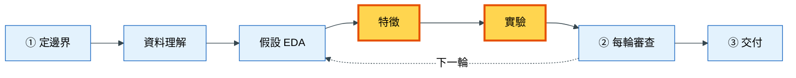
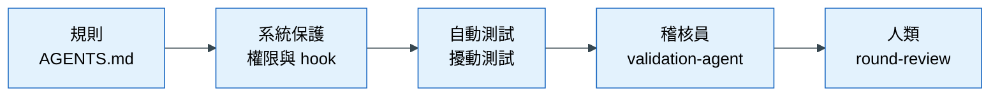
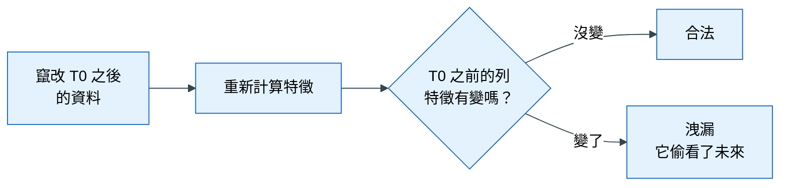

# 落地 3｜驗證規則與防洩漏機制

## 這一章要解決什麼問題

退貨預測專案進行到第二輪。AI 回報：「加入三個新特徵後，模型分數從 0.30 跳到 0.55，而且三次驗證每一次都進步。」聽起來是重大突破。你仔細一看，其中一個特徵叫做「顧客這筆訂單之後 7 天內的客服來電次數」。

問題很明顯：訂單剛成立的時候（T0），「之後 7 天的來電」還沒有發生。模型在驗證時表現很好，是因為它偷看了未來；真的上線後，這個值永遠是 0，模型會立刻失靈。這就是**資料洩漏**。

洩漏最可怕的地方是：它不會讓程式出錯，反而會讓分數變好，而且在每一次驗證都穩定進步。只靠人眼檢查，很容易被漂亮的數字說服；只靠在文件裡寫「不要洩漏」，AI 也可能忘記或誤解。所以這個模板把防洩漏做成**好幾道自動化的防線**。這一章介紹這些防線各自擋什麼、擋不住什麼。

## 心法回顧

教科書第 3 章的核心問題是：「**預測那一刻，這個值存在嗎？**」驗證的目的是模擬上線那一刻，所以切分方式要符合上線情境（預測未來就用時間切分、預測新客戶就用群組切分），而且最終答案（holdout，最後只看一次的保留集）只能看一次。教科書也提到「穩定進步不等於合法」：洩漏的特徵同樣會在每次驗證都進步，所以需要**擾動測試**（故意竄改未來的資料，看特徵會不會跟著變）。（教科書 [03 資料切分與洩漏](../textbook/03_split_and_leakage.md)；術語見 [術語表](../textbook/glossary.md)）

## 本章在整個流程的位置

防洩漏機制主要在「特徵」與「實驗」兩個階段發揮作用：

這些防線的判斷依據，都來自第一章 `brief.md` 的 §3（資訊可得性）與 §4（驗證與指標）。

## 步驟

這一章的「步驟」不是要你每次手動執行，而是讓你理解每一道防線為什麼存在、什麼時候會啟動。

### 步驟 1：驗證規則寫進程式，而且 AI 不能改

**為什麼要這樣做**：如果 AI 可以自己決定怎麼切分資料，它可能為了讓分數好看而選一個比較「容易」的切法，例如把時間序列隨機打散。所以 `brief.md` §4 由人類決定切分方式、主指標與基準之後，AI 要把它實作成程式，並且**不准自行更改規則**。

**怎麼做**：第一次跑實驗時，AI 依照 `brief.md` §4 在 `src/<pkg>/validation/` 實作切分、交叉驗證與指標。之後所有實驗都呼叫同一份程式，確保每次比較都在相同的條件下進行。

**怎樣算完成**：所有實驗都用同一套切分與指標；沒有任何實驗自己寫了另一種切法。

### 步驟 2：原始資料與最終答案由系統保護

**為什麼要這樣做**：原始資料一旦被改，任何結果都無法重現；最終答案（holdout）一旦被看過，它就失去「估計上線表現」的能力。這兩件事光靠規定不夠，必須由系統擋下來。

**怎麼做**：模板設了兩層保護，你不需要做任何事：

| 保護 | 擋什麼 | 怎麼運作 |
|---|---|---|
| 權限設定（`.claude/settings.json`） | AI 讀取 holdout 資料夾、寫入 `data/raw/` | Claude Code 直接拒絕這些操作 |
| `guard_paths.py`（hook） | 同上，另外也檢查 AI 下的終端機指令 | 只要指令內容碰到 holdout 路徑，或可能修改 `data/raw/`，就擋下並說明原因 |

**怎樣算完成**：AI 被擋下時，會說明原因而不是想辦法繞過。如果 AI 試圖繞過，這本身就是一個需要回報的問題。

### 步驟 3：改了正式程式，就自動跑洩漏測試

**為什麼要這樣做**：特徵程式一旦進入 `src/`，就會影響最終模型。如果每次都要記得手動檢查，總有一次會忘記。所以模板讓「檢查」自動發生在「修改」之後。

**怎麼做**：每當 AI 修改了 `src/` 底下的 Python 檔案，`post_edit_tests.py` 這個 hook 會自動執行 `tests/test_leakage*.py`：

- 測試失敗 → AI 收到失敗訊息，**必須先修好**才能繼續
- 還沒有洩漏測試檔 → 一樣會擋下，並提醒 AI 依 `leakage-audit` 先建立測試

Codex 沒有 hook，但模板另外設了 **pre-commit**：每次 commit 時自動檢查三件事：不能提交原始資料、兩邊的 skill 內容必須一致、`src/` 有改動時要跑洩漏測試。

**怎樣算完成**：洩漏測試存在，而且每次修改 `src/` 後都是通過的。

### 步驟 4：擾動測試：證明特徵沒有偷看未來

**為什麼要這樣做**：開頭的例子裡，「之後 7 天的來電次數」名字就很可疑，但更多洩漏的特徵名字看起來完全正常，例如「顧客平均消費」。如果這個平均是用全部資料算的，就包含了 T0 之後的消費。光看名字擋不住，光看分數也擋不住（它在每次驗證都會穩定進步），需要一種直接證明的方法。

**怎麼運作**：擾動測試的邏輯很簡單：一個合法的特徵只用了 T0 之前的資訊，所以**未來的資料怎麼改，它都不應該變**。測試會：

1. 準備一份小型的模擬資料
2. 把「T0 之後才會被觀察到」的資訊打亂，而且只把時間往**更晚**移
3. 重新計算特徵，檢查 T0 之前的那些列，特徵值是否完全沒變
4. 另外放一個**故意洩漏**的反例，確認測試真的抓得到

為什麼只能往「更晚」移？因為如果把未來的事件移到過去，原本合法的歷史特徵也會跟著改變，測試就會誤判。

**怎樣算完成**：每個特徵群組都通過擾動測試；故意洩漏的反例被抓到。

### 步驟 5：分數變好之後，交給稽核員

**為什麼要這樣做**：前面幾道防線都是自動的，但有些問題只有讀程式、看紀錄才能發現，例如驗證設計本身錯了、前處理在全部資料上計算、某次進步只發生在一次驗證裡。做實驗的 AI 很容易被自己的分數說服，所以要由另一個角色來檢查。

**怎麼做**：分數變好之後，對 AI 說「請 validation-agent 審查這一輪的增益」。`validation-agent` 是一個**只能讀、不能改**檔案的 AI 分身，它的任務是**試著推翻**「模型變好了」這個說法。

**會產出什麼**：判定「放行 / 有條件放行 / 駁回」，每一項都附證據。

**怎樣算完成**：重大進步都經過稽核；被駁回的部分有修正或放棄。

## 概念圖

### 圖一：五道防線，由寬到嚴

**為什麼需要這張圖**：學員常問「已經有測試了，為什麼還需要稽核員？已經有規則了，為什麼還需要 hook？」這張圖說明每一道防線都會漏掉一些東西，所以要疊起來用。

**怎麼讀這張圖**：由左到右，每一道防線都在接住前一道漏掉的問題。

| 防線 | 擋得住 | 擋不住 |
|---|---|---|
| 規則（AGENTS.md） | AI 的預設行為 | AI 忘記或誤解規則 |
| 系統保護（權限、hook） | 碰觸原始資料或最終答案 | 邏輯上的洩漏 |
| 自動測試（擾動測試） | 特徵用到未來的資訊 | 驗證設計本身錯誤 |
| 稽核員 | 不穩健的進步、可疑的跳升 | 業務上不合理的目標 |
| 人類審查 | 以上所有的漏網之魚 | ——所以人類閘門不能省 |

### 圖二：擾動測試的邏輯

**為什麼需要這張圖**：擾動測試是最強的一道防線，但它的邏輯有點反直覺：「改資料，然後期待結果**不變**」。這張圖把邏輯畫出來。

**怎麼讀這張圖**：把它想成「換掉答案卷，看考生的答案會不會跟著變」。如果特徵只用了過去的資訊，未來怎麼改都不會影響它，結果就是「沒變 → 合法」；如果特徵跟著變了，就證明它在計算時用到了未來的資料。

## 用到的 skill 與 subagent

| Skill / subagent | 它做什麼 | 什麼時候用 | 你要檢查什麼 | 為什麼要檢查這個 |
|---|---|---|---|---|
| `leakage-audit` | 逐項走洩漏檢查清單（8 項），並說明擾動測試怎麼寫 | 分數突然變好、新增歷史或聚合特徵、使用目標編碼時 | 判定是否附了測試輸出或程式位置 | 口頭說「沒問題」不算證據 |
| | | | 歷史聚合是否嚴格只用 T0 之前的資料，並排除自己 | 這是最常見、也最難從名字看出來的洩漏 |
| `experiment-protocol` | 規定所有比較都用同一套切分與指標 | 任何比較 | 有沒有實驗自己改了切分方式 | 切分不同的實驗，分數不能互相比較 |
| `validation-agent` | 唯讀稽核，試著推翻「模型變好了」 | 任何「分數變好了」之後 | 判定是否每一項都附證據 | 稽核員也可能出錯，證據讓你能自己判斷 |
| | | | 證據不足時，是否指出缺哪一個事實 | 這讓你知道下一步該補什麼 |

## 講師口述要點

- 用「之後 7 天的來電次數」開場，再追問：「如果特徵名字叫『顧客平均消費』，你還看得出來嗎？」
- 強調洩漏的危險在於它「讓分數變好」，而且會在每次驗證都穩定進步
- 每一道防線都有漏洞，所以要疊起來用；最後一道永遠是人
- 擾動測試的直覺：換掉答案卷，看答案會不會跟著變
- 討論題：如果 hook 在第一時間就擋下洩漏，學員還會理解問題出在哪裡嗎？自動化防線不能取代理解

## 檢核清單

- [ ] 能說出「預測那一刻，這個值存在嗎？」這句話的用途
- [ ] 知道切分方式由 `brief.md` §4 決定，AI 不能自行更改
- [ ] 知道哪些資料夾受系統保護，以及為什麼
- [ ] `tests/test_leakage*.py` 存在，修改 `src/` 後會自動執行
- [ ] 每個特徵群組都通過擾動測試，而且有一個故意洩漏的反例被抓到
- [ ] 重大的分數進步都經過 `validation-agent` 審查
