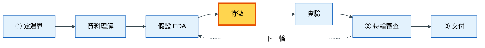
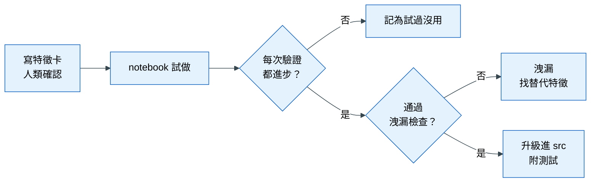

# 落地 4｜特徵從原型到上線

## 這一章要解決什麼問題

上一輪 EDA 發現「新客戶比較容易退貨」，你決定把它做成特徵。AI 很快寫好了，分數也小幅上升。接下來幾天，你們又陸續加了二十幾個特徵。到了第三週，模型的分數不錯，但你遇到三個麻煩：

1. 主管問「哪幾個特徵最重要、為什麼？」你說不出來，因為很多特徵是 AI 順手加的，你不記得它們的定義。
2. 同一段計算「顧客歷史」的程式，在五個 notebook 裡各寫了一份，而且五份的結果不完全一樣。
3. 其中有一個特徵後來被發現有洩漏，但你不知道它被用在哪些實驗裡，也不知道之前報告的分數哪些可以相信。

這些麻煩的根源是：特徵沒有一個**從想法到上線的固定流程**。這一章介紹模板裡一個特徵的生命週期：先寫清楚、再試做、證明有用又合法之後，才升級成正式程式。

## 心法回顧

教科書第 4 章說：特徵是把領域知識**翻譯**成模型看得懂的訊號。好的特徵講得出三件事：它來自哪個假設、在預測當下（T0）拿得到、加入後的進步是穩健的。特徵的價值是**邊際的**：一個特徵單獨看很強，但如果它的資訊和既有特徵重複，加進去就沒有幫助。（教科書 [04 特徵工程](../textbook/04_feature_engineering.md)；術語見 [術語表](../textbook/glossary.md)）

## 本章在整個流程的位置

特徵的材料來自上一章假設卡裡的「T0 代理特徵」；做好之後，交給下一章的實驗來證明有沒有用。

## 步驟

### 步驟 1：動手之前，先寫特徵卡

**為什麼要做這一步**：開頭的第一個麻煩是「說不出特徵的定義和理由」。如果在寫程式之前就把特徵的來源、定義和可得性寫清楚，這個問題就不會發生。另外，很多洩漏在「寫定義」這一步就能被發現：當你被迫寫出「這個值在 T0 拿得到嗎？用到哪些欄位？」時，問題往往自己浮現。

**怎麼做**：對 AI 說：

> 用 feature-card 做「顧客過去 90 天的退貨比例」。

AI 會先寫出以下內容，**給你確認後才動手**：

| 項目 | 要回答什麼 | 為什麼要寫 |
|---|---|---|
| 來源 | 來自哪個假設或發現 | 講得出理由，之後才解釋得了 |
| 精確定義 | 分母是 0 怎麼辦？缺失怎麼處理？新顧客沒有歷史怎麼辦？ | 模糊的定義會讓不同人算出不同結果 |
| T0 可得性 | 用到的每個欄位，對照 `brief.md` §3 | 這是防洩漏的第一道檢查 |
| 洩漏風險 | 歷史統計是否只用 T0 之前的資料，並排除這筆訂單自己 | 歷史類特徵是最常見的洩漏來源 |
| 預期方向 | 預期這個值越高，退貨機率越高還是越低 | 結果和預期相反時，可能是程式錯了 |
| 可能重疊 | 和哪些既有特徵相似 | 重疊的特徵加進去通常沒有增益 |

**會產出什麼**：特徵卡的內容記錄在 `knowledge/log.md`，和這次的實驗結果放在同一段。

**怎樣算完成**：你讀過並同意這張特徵卡。

### 步驟 2：在 notebook 裡試做

**為什麼要做這一步**：大部分的特徵試做之後會發現沒有用。如果每個想法都直接寫成正式程式、補齊測試，大部分的工夫會白費。所以先在 `notebooks/` 裡快速試做；這個資料夾的程式是「用完即丟」的，不用寫得很完整。

**怎麼做**：AI 把特徵寫成一個函式 `build(base, tables) -> DataFrame`，規則是：輸出和原本的資料表同樣的列數與順序、只回傳新增的欄位、不修改輸入的資料。這些規則讓特徵可以被單獨加入或拿掉，方便下一步比較。

**怎樣算完成**：特徵算得出來，數值範圍合理。

### 步驟 3：和目前最好的組合做比較

**為什麼要做這一步**：特徵的價值是邊際的。一個特徵單獨看可能很強，但重要的是：**在目前已經有的特徵之外，再加上它，是否還有進步？**

**怎麼做**：對 AI 說「和目前最佳組合做配對比較」。AI 會依照 `experiment-protocol` 跑兩次實驗：一次是目前最佳組合，一次是加上新特徵，然後在每一次驗證（fold）上逐一比較。細節見下一章。

**怎樣算完成**：得到結論：每次驗證都進步（穩健），或只有平均進步，或沒有進步。

### 步驟 4：有進步的話，先檢查洩漏

**為什麼要做這一步**：上一章說過，洩漏的特徵也會穩定進步。所以「有進步」之後，不是直接採用，而是先證明它合法。

**怎麼做**：對 AI 說「用 leakage-audit 檢查這個特徵」。AI 會走一遍檢查清單，並在升級時補上擾動測試。

**怎樣算完成**：判定為「乾淨」，並附測試輸出。

如果沒有進步，就把這個特徵記為「試過但沒用」，並寫明原因：和既有特徵重疊、只在某些月份有效，或根本沒有訊號。這些紀錄會在每輪審查時被整理進 `findings.md`，避免以後重做。

### 步驟 5：升級成正式程式

**為什麼要做這一步**：開頭的第二個麻煩是「同一段程式在五個 notebook 裡各寫一份」。當一段邏輯會被重複使用、會影響最終模型，或要給別人重現結果時，就應該把它搬到一個固定的地方、寫成標準的形式、附上測試，這就是 `src/`。

**升級條件**（符合任一條）：

1. 同一段邏輯第二次被用到
2. 會影響最終模型
3. 要交付、排程或重現報告數字

都不符合的話，就留在 `notebooks/`，不要升級。這是為了避免花時間把沒用的程式寫得很完整。

**怎麼做**：對 AI 說「把這個特徵升級進 src」。AI 會：

1. 把程式改寫成純函式，放到 `src/<pkg>/features/<群組>.py`
2. 在 `tests/` 補上洩漏擾動測試與數值範圍測試
3. 把原本的 notebook 改成呼叫 `src/` 的函式，確認結果一致
4. 在 `knowledge/log.md` 記下升級了什麼、放在哪裡

**怎樣算完成**：修改 `src/` 時，hook 自動跑洩漏測試並通過；notebook 改成從 `src/` 匯入。

## 概念圖

### 圖一：一個特徵的生命週期

**為什麼需要這張圖**：一個特徵從想法到上線要經過好幾關，學員常常跳過其中幾關（尤其是「寫特徵卡」和「檢查洩漏」）。這張圖把每一關排出來，並標出兩個可能的出口。

**怎麼讀這張圖**：從左邊開始。特徵卡由人類確認後才試做；試做之後要過兩個關卡：先問「有沒有穩健的進步」，再問「是不是合法」。兩關都通過，才會升級成正式程式。注意「有進步」之後還要檢查洩漏，順序不能顛倒：沒有進步的特徵不值得花時間檢查，有進步的特徵則必須證明它不是因為偷看未來才進步。

### 圖二：notebooks 和 src 的分工

**為什麼需要這張圖**：學員常問「為什麼不一開始就寫在 `src/`？」或「為什麼不全部留在 notebook？」這張圖說明兩者各自的角色。

**怎麼讀這張圖**：大部分的想法停在左邊，試過沒用就丟掉；只有證明有價值的才會往右走。報告裡的最終數字只能來自 `src/` 的程式，因為只有那裡的程式有測試保證、可以被重現。

| | `notebooks/` | `src/` |
|---|---|---|
| 目的 | 快速試錯 | 長期使用 |
| 需要測試嗎 | 不需要 | 必須，特徵一定要有洩漏測試 |
| 能產生報告數字嗎 | ✗ | ✓ |

## 用到的 skill 與 subagent

| Skill / subagent | 它做什麼 | 什麼時候用 | 你要檢查什麼 | 為什麼要檢查這個 |
|---|---|---|---|---|
| `feature-card` | 動手前先寫清楚特徵；試做後依結果決定升級或記為沒用 | 新增或評估一個特徵時 | 每個用到的欄位都對照過 `brief.md` §3 | 這是最便宜的防洩漏時機 |
| | | | 有沒有寫出可能重疊的既有特徵 | 重疊的特徵通常沒有邊際價值 |
| `leakage-audit` | 洩漏檢查清單與擾動測試 | 特徵有進步之後、升級之前 | 有沒有測試輸出 | 口頭判斷不算證據 |
| `promote-to-src` | 把符合條件的程式升級成正式程式，補測試 | 符合升級條件時 | 是不是只升級需要的那一段，而不是整個 notebook | 預先建立「也許用得到」的架構，只會增加維護成本 |
| `feature-agent` | 專門做特徵的 AI 分身，不能修改切分、指標或 `brief.md` | 想把一整張特徵卡交出去時 | 回報是否包含新增的欄位、洩漏測試結果、建議的比較組合 | 讓你知道它做了什麼、證據是什麼 |

## 講師口述要點

- 用「三週後說不出特徵定義」的情境開場，說明特徵卡的價值
- 特徵卡是最便宜的防洩漏時機：寫定義時就被迫回答「T0 拿得到嗎」
- 大部分特徵試做後都沒用，這很正常；所以先試做、後升級
- 「有進步」和「合法」是兩個獨立的關卡，順序不能顛倒
- 升級條件只有三條；不符合就留在 notebook，不要過度工程化

## 檢核清單

- [ ] 每個特徵在動手前都有特徵卡，並由人類確認
- [ ] 特徵卡寫出了 T0 可得性與洩漏風險
- [ ] 每個特徵都和目前最佳組合做過配對比較
- [ ] 沒有用的特徵被記為「試過但沒用」，並寫明原因
- [ ] 升級進 `src/` 的特徵都通過洩漏擾動測試
- [ ] 報告中的數字都來自 `src/` 的程式
