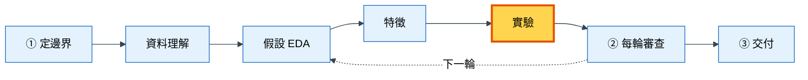
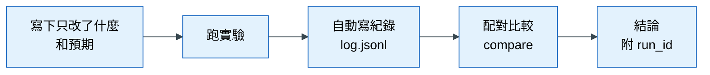

# 落地 5｜實驗紀錄與模型比較

## 這一章要解決什麼問題

退貨預測專案到了第三輪。你翻開筆記，看到上週寫著「模型 B 比模型 A 好，0.31 對 0.30」。但你想不起來：

- 這兩個分數用的是同一組特徵嗎？
- 是同一種切分方式嗎？
- 0.01 的差距，是真的進步，還是剛好某個月份比較好預測？
- 這個 0.31 是哪一段程式、哪一個版本跑出來的？

如果這些問題答不出來，0.31 這個數字就沒有辦法相信，也沒有辦法寫進報告。這一章介紹模板裡的實驗規範：**每次只改一項、每次都留紀錄、用同一次驗證互相比較**，讓每一個數字都可信、可追溯。

## 心法回顧

教科書第 5 章說：模型是畫龍點睛，**先有基準，再談升級**。比較兩個做法時，要固定切分、特徵和評分方式，一次只改一個東西；判斷進步要用**同 fold 配對比較**：在同一次驗證（fold）上比較兩個做法，每一次都贏才算穩健，而不是只看平均分數。（教科書 [05 模型選擇與評估](../textbook/05_model_selection.md)、[03 資料切分與洩漏](../textbook/03_split_and_leakage.md)；術語見 [術語表](../textbook/glossary.md)）

## 本章在整個流程的位置

實驗是每一輪的裁判：特徵、模型、參數有沒有用，都在這裡決定。

## 步驟

### 步驟 1：先建立紀錄工具

**為什麼要做這一步**：開頭的問題，根源是「分數沒有和它的條件一起被記下來」。要解決它，最可靠的方法是讓紀錄自動發生：每跑一次比較，就由程式寫下一行完整的紀錄。

**怎麼做**：第一次跑實驗時，AI 會依照 `experiments/README.md` 的欄位規定，建立 `src/<pkg>/tracking.py`，裡面有兩個函式：

| 函式 | 做什麼 |
|---|---|
| `log_run(...)` | 把一次實驗的完整資訊追加成一行，寫進 `experiments/log.jsonl` |
| `compare(runs, baseline)` | 對多個實驗做同 fold 配對比較，算出平均增益、增益的波動、幾個 fold 進步、是否穩健 |

每一行紀錄至少包含：唯一編號 `run_id`、時間、程式版本（git commit）、輪次、完整的特徵清單、模型與參數、主指標、**每一個 fold 的分數**，以及平均與標準差。

**為什麼要記「每一個 fold 的分數」**：因為配對比較需要它。只記平均，就無法知道進步是不是只發生在某一次驗證。

**為什麼「只追加、不修改」**：錯的實驗也是紀錄。如果可以刪改，就無法證明報告裡的數字沒有被挑選過。

**怎樣算完成**：`experiments/log.jsonl` 存在，每次比較都會自動多一行。

### 步驟 2：先跑基準

**為什麼要做這一步**：一個模型分數 0.30，是好還是壞？沒有比較對象就無法判斷。基準就是那個比較對象。模板要求兩種基準：

| 基準 | 是什麼 | 回答的問題 |
|---|---|---|
| 不學習的基準 | 分類：永遠猜整體的正例比例；數量：永遠猜平均；時間序列：上週同一天的值 | 模型值得做嗎？ |
| 簡單模型基準 | 同一種模型，只用原始欄位，不加任何特徵工程 | 特徵工程值得做嗎？ |

**怎麼做**：對 AI 說「依 experiment-protocol 先跑兩種基準」。用哪一種基準由 `brief.md` §4 決定。

**怎樣算完成**：`log.jsonl` 裡有兩種基準的紀錄。

### 步驟 3：每次只改一項

**為什麼要做這一步**：如果同時換了模型、又加了特徵，分數變好時你就不知道是誰的功勞。就像做菜時同時多加鹽又多加糖，味道變好了，你不知道該感謝哪一樣。

**怎麼做**：每次比較前，先寫下「這次只改了什麼」和「預期會怎樣」。可以改的是：一個特徵群組、一個模型，或一組參數。切分方式、交叉驗證、主指標和隨機種子（seed）必須固定。

**怎樣算完成**：每一筆紀錄都說得出「和上一筆只差在哪裡」。

### 步驟 4：用配對比較判斷是否進步

**為什麼要做這一步**：開頭的例子裡，B 平均比 A 高 0.01。但三次驗證的難度可能差很多：如果第一個月特別好預測，平均數會被那個月帶著走。配對比較的做法是在**同一次驗證**上比 A 和 B，看 B 是每一次都贏，還是只在某一次大贏。

**怎麼做**：對 AI 說「用 compare 比較這兩次實驗」。判斷規則如下：

| 情況 | 判定 | 該怎麼做 |
|---|---|---|
| 每個 fold 都進步，而且平均增益大於增益的波動 | **穩健**（robust） | 可以採用 |
| 只有平均變好 | 不能宣稱有效 | 記下來，不採用 |
| 單次大幅進步 | 可疑 | 先做洩漏檢查，再交給 validation-agent |

另外也要看**過擬合差距**（訓練分數減去驗證分數）：如果差距變大，代表模型可能在背答案。

**怎樣算完成**：每個結論都附 `run_id`，而且是用 `compare` 判斷的，不是只看平均。

### 步驟 5：看模型錯在哪裡

**為什麼要做這一步**：分數只告訴你「好多少」，不告訴你「下一步該做什麼」。找出模型錯在哪些地方，才能產生下一輪的假設。

**怎麼做**：對 AI 說「用 error-analysis 看模型錯在哪」。AI 會：

1. 取每一筆資料在它當驗證集時的預測
2. 依類別、數值區間、時間切片，找出表現最差的群體
3. 看最嚴重的誤判各 20 筆，找共同點
4. 把每個發現分成兩類：
   - **可約誤差**：缺少某個資訊，可以做成特徵改善 → 成為下一輪的假設
   - **不可約誤差**：預測當下這個資訊根本不存在（例如顧客收到商品後才改變心意）→ 這不是模型的失敗，而是要告訴決策者的限制

事後分析時，**可以用 T0 之後的欄位**，因為這是在解釋錯誤，不是在做特徵。

**怎樣算完成**：得到 1–3 個下一輪要驗證的假設，以及「模型做不到」的清單。

## 概念圖

### 圖一：一次實驗從開始到結論

**為什麼需要這張圖**：學員常常跑完實驗就直接看平均分數下結論。這張圖說明一次合格的實驗要經過哪些步驟。

**怎麼讀這張圖**：由左到右。最容易被跳過的是第一步（寫下改了什麼和預期）和第四步（配對比較）。沒有第一步，你不知道分數的變化該歸功於誰；沒有第四步，你可能被平均數騙了。最後的結論一定要附 `run_id`，這樣任何人都能回頭找到這次實驗的完整條件。

### 圖二：為什麼要配對比較

**為什麼需要這張圖**：「配對比較」是本章最重要也最不直覺的觀念。用一個簡單的例子說明。

假設兩個做法在三個月份的分數如下：

| 驗證月份 | 做法 A | 做法 B | B − A |
|---|---|---|---|
| 第 1 個月（比較難） | 0.20 | 0.21 | +0.01 |
| 第 2 個月 | 0.30 | 0.31 | +0.01 |
| 第 3 個月（比較容易） | 0.40 | 0.41 | +0.01 |
| 平均 | 0.30 | 0.31 | +0.01 |
| 標準差 | 0.10 | 0.10 | **0.00** |

**怎麼讀這張表**：如果只看平均和標準差，A 和 B 都是「0.30 ± 0.10」左右，差距 0.01 被月份之間 0.10 的波動淹沒，看起來不顯著。但如果看最右邊一欄，B 在**每一個月**都贏 0.01，而且增益完全沒有波動，這是非常穩健的進步。月份之間的差異來自「每個月的難度不同」，和哪個做法比較好無關；配對比較把這個干擾消掉了。

反過來，如果 B 在第 3 個月贏了 0.05，另外兩個月都輸 0.01，平均一樣是 +0.01，但這就不是穩健的進步。

## 用到的 skill 與 subagent

| Skill / subagent | 它做什麼 | 什麼時候用 | 你要檢查什麼 | 為什麼要檢查這個 |
|---|---|---|---|---|
| `experiment-protocol` | 規定實驗步驟、建立紀錄工具、用配對比較判斷 | 任何比較：特徵、模型、參數 | 是否只改了一項 | 同時改多項，無法歸因 |
| | | | 有沒有先跑基準 | 沒有基準的比較不成立 |
| | | | 結論是否用 `folds_improved` 和 `robust` 判斷 | 平均數可能被某個月份帶著走 |
| `error-analysis` | 切片找出最弱的群體，區分可約與不可約誤差 | 想知道模型錯在哪、下一步做什麼時 | 每個發現是否分成可約或不可約 | 可約的變成下一輪假設；不可約的要告訴決策者 |
| `model-agent` | 專門跑實驗的 AI 分身，不能修改切分或指標，也不能用最終答案調整模型 | 想把一整輪比較交出去時 | 回報是否包含比較表（附 `run_id`）與「最可疑的結果」 | 主動指出可疑結果，是自我質疑的一部分 |

## 講師口述要點

- 用「想不起 0.31 是怎麼來的」開場，說明紀錄的價值
- 兩種基準回答兩個不同的問題：「模型值得做嗎？」「特徵工程值得做嗎？」
- 一次只改一項，就像做菜一次只改一種調味料
- 用三個月份的表格講配對比較：月份難度的差異會掩蓋真正的進步
- 錯誤分析可以用 T0 之後的欄位，因為這是解釋，不是特徵
- 不可約誤差不是失敗，而是要告訴決策者的限制

## 檢核清單

- [ ] `experiments/log.jsonl` 存在，每一行都有 `run_id`、特徵清單和每個 fold 的分數
- [ ] 兩種基準都跑過了
- [ ] 每次比較都只改一項，並事先寫下預期
- [ ] 每個「有進步」的結論都附 `run_id`，並由配對比較判斷
- [ ] 單次大幅進步都先做過洩漏檢查
- [ ] 錯誤分析產生了下一輪的假設，以及「模型做不到」的清單
