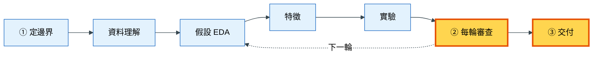
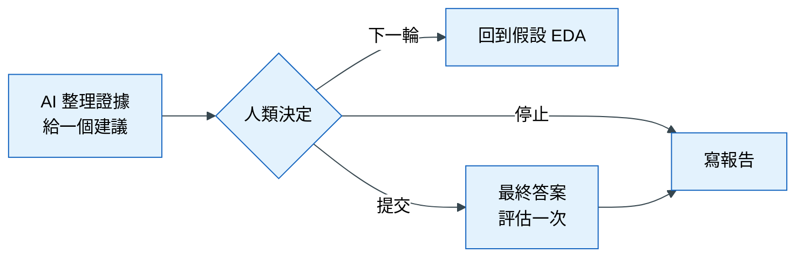
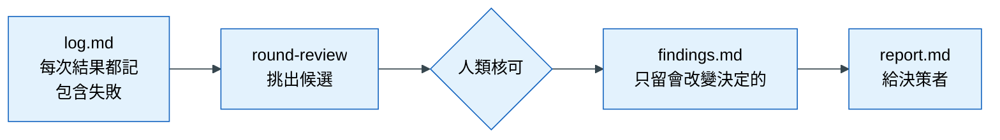

# 落地 6｜每輪審查與交付

## 這一章要解決什麼問題

退貨預測專案已經跑了四輪，`knowledge/log.md` 累積了六十幾段紀錄，`experiments/log.jsonl` 有一百多筆實驗。AI 很勤快，每一輪都提出新的想法，分數也還在緩慢上升。這時候有三個問題沒有人回答：

1. **什麼時候該停？** 每一輪都有新點子，如果讓 AI 自己決定，它會一直做下去。
2. **哪些結論值得記住？** 六十幾段紀錄裡，大部分是「試了一下、差不多」，真正重要的結論被淹沒了。下一個接手的人（或下一次對話的 AI）只能從頭讀起。
3. **最後的分數能相信嗎？** 如果在過程中曾經偷看最終答案來調整模型，報告的分數就會高估上線表現。

這一章介紹流程的最後兩道人類閘門：每一輪結束時的**審查**，以及專案結束時的**交付**。

## 心法回顧

教科書第 6 章說：AI 讓實驗變便宜，所以「判斷哪個實驗可信、何時停止、留下什麼」變成人類最重要的工作。記錄是協作的記憶：AI 沒有跨對話的記憶，只有被寫下來的結論能延續到下一輪。教科書第 3 章也說過：最終答案（holdout，最後只看一次的保留集）只能看一次，看過之後再回頭調整，那個分數就不再可信。（教科書 [06 人機協作的資料科學](../textbook/06_human_ai_collaboration.md)、[03 資料切分與洩漏](../textbook/03_split_and_leakage.md)；術語見 [術語表](../textbook/glossary.md)）

## 本章在整個流程的位置



每輪審查決定要回到「假設 EDA」開始下一輪，還是往右走到交付。

## 步驟

### 步驟 1：過程自動記錄

**為什麼要做這一步**：失敗的嘗試和成功的一樣有價值，因為它告訴下一輪「這條路不用再走」。但如果要人提醒才記錄，失敗的部分幾乎一定會被省略。所以模板規定：**AI 每次回報結果，都要自動在 `knowledge/log.md` 追加一段**，不用等人類要求。

**怎麼做**：你不需要做任何事。每一段的格式固定為：

```
## R<輪次>-<序號> · <日期> · <這次想回答的問題>
- 做了什麼：
- 結果：（數字，附 run_id）
- 結論：支持 / 推翻 / 不確定 / 卡住
- 坑或困難：
- 下一步：
```

舊段落不改寫；寫錯了就在下面追加更正。數字一定要來自實際跑過的程式，並附 `run_id`。

**怎樣算完成**：每次 AI 回報結果後，`log.md` 都多了一段；失敗和卡關也有記錄。

### 步驟 2：每輪結束時說「round-review」

**為什麼要做這一步**：這是第二道人類閘門。AI 可以整理證據、給建議，但「下一步要做什麼」牽涉到時間、成本與風險，必須由人決定。而且如果沒有固定的審查點，專案會變成無止盡地「再試一個」。

**怎麼做**：一輪結束時，對 AI 說「round-review」。AI 會依序整理：

| 區塊 | 內容 | 為什麼需要 |
|---|---|---|
| 這一輪的摘要 | 試了什麼、哪些穩健進步、哪些沒用、洩漏檢查結果、目前最佳 vs 基準 | 讓你在幾分鐘內掌握這一輪 |
| 對照停止條件 | 逐條對照 `brief.md` §5：門檻、目前狀況、是否達成 | 停止與否依事先約定的標準，不憑感覺 |
| 沉澱候選 | 3–5 條值得留下的結論 | 從大量紀錄中挑出真正重要的 |
| 建議 | **只給一個**：下一輪、停止或提交，並說理由 | 多個選項等於把判斷丟回給你 |
| 請你決定 | 「留哪幾條？下一輪、停止，還是提交？」 | 決定權在人類 |

**怎樣算完成**：你做出決定，AI 在 `log.md` 追加一段「R<n> 結束：決定 ___」。

### 步驟 3：決定哪些結論留下來

**為什麼要做這一步**：`log.md` 是過程，`findings.md` 是結論。如果什麼都往 `findings.md` 放，它很快就會和 `log.md` 一樣長，沒有人會讀。所以只有符合以下條件之一的，才值得留下：

1. 會改變下一步的決定（例如「這類特徵沒有用，別再試」）
2. 會改變對業務的說法（例如「模型抓不到收貨後才發生的原因」）
3. 會讓人再踩一次的坑（例如「這張表一筆訂單多列，直接合併金額會重複」）

只是「跑了一個實驗、分數差不多」的，留在 `log.md` 就好。

**怎麼做**：從 AI 列出的候選中，選出你要留下的。AI 會把它們寫進 `knowledge/findings.md` 的三個區塊：

| 區塊 | 放什麼 |
|---|---|
| 給決策者 | 模型能做到什麼、做不到什麼、需要主管決定什麼 |
| 發現 | 一句話一條結論，附證據與對業務的意義 |
| 試過但沒用的 | 嘗試、結果、原因，避免以後重做 |

資料的坑也會同步補進 `knowledge/data.md`。

**怎樣算完成**：`findings.md` 只包含你核可的結論。

### 步驟 4：決定提交時，最終答案只評估一次

**為什麼要做這一步**：這是第三道人類閘門。最終答案（holdout）是整個專案唯一沒有被用來做任何調整的資料，所以它的分數最接近上線後的真實表現。但只要看過一次分數再回頭修改模型，它就變成另一份驗證資料，失去這個價值。所以它只能用一次，而且由人類保管與執行。

**怎麼做**：

1. 在 round-review 中，**你**決定「提交」
2. 產生最終的預測檔，放在 `submissions/`，一個專案只交一份
3. 由人類拿最終答案評估一次（AI 讀不到這份資料，系統會擋下）
4. 在 `experiments/log.jsonl` 記一行 `kind: holdout`，包含檔名、分數和對應的交叉驗證 `run_id`
5. 更新 `findings.md` 的「給決策者」

如果是 Kaggle 比賽，排行榜就扮演最終答案的角色。挑最終成績時，要挑**交叉驗證最穩定的**，而不是排行榜分數最高的，因為公開排行榜只用了部分資料，容易誤導。

**怎樣算完成**：`submissions/` 只有一份檔案，`log.jsonl` 有一筆 `kind: holdout` 的紀錄。

### 步驟 5：寫給決策者的報告

**為什麼要做這一步**：主管不需要知道模型的細節，他需要知道「這個東西能幫我做什麼決定、可以信任到什麼程度」。如果報告從方法開始寫，主管讀到第三頁還找不到結論。

**怎麼做**：對 AI 說「用 report-writer 寫報告」。報告放在 `reports/report.md`，依照「結論先行」的結構：

| 段落 | 內容 |
|---|---|
| 標題 | 一句話結論：主管不讀後文也能做決定 |
| 1. 決策建議 | 最多 3 點，對應 `findings.md` 的「需要你決定」 |
| 2. 能做什麼 | 用業務語言，例如「名單中每 100 筆有 30 筆真的會退貨，是隨機挑選的 3 倍」 |
| 3. 證據 | 只放穩健的進步，每個數字附 `run_id` |
| 4. 我們排除了什麼 | 沒用的特徵、被推翻的假設、擋下的洩漏 |
| 5. 限制與風險 | 預測不等於因果、資料分布可能改變、不可約誤差 |
| 6. 下一步 | |

**怎樣算完成**：每個數字都能對到 `log.jsonl` 的 `run_id`；沒有學過資料科學的人也讀得懂。

## 概念圖

### 圖一：每輪審查的決策

**為什麼需要這張圖**：這張圖說明 round-review 裡 AI 和人類各自負責什麼，以及三種可能的結果。



**怎麼讀這張圖**：左邊是 AI 的工作：整理這一輪的證據，並給出**一個**建議。中間的菱形是人類閘門。三條路中，「下一輪」回到循環；「停止」代表不提交、直接總結；「提交」則先用最終答案評估一次，再寫報告。無論哪一條，決定都是人類做的。

### 圖二：從過程到結論

**為什麼需要這張圖**：學員常常分不清 `log.md` 和 `findings.md` 的差別。這張圖說明資訊怎麼從大量的過程紀錄，被篩選成少量的結論。



**怎麼讀這張圖**：由左到右，資訊越來越少、越來越精煉。`log.md` 什麼都記；round-review 從中挑出候選；人類決定哪些值得留下，寫進 `findings.md`；最後報告只引用 `findings.md` 裡的結論。這就是為什麼報告裡的每一句話都能追溯回原始的實驗紀錄。

## 用到的 skill 與 subagent

| Skill / subagent | 它做什麼 | 什麼時候用 | 你要檢查什麼 | 為什麼要檢查這個 |
|---|---|---|---|---|
| `knowledge-capture` | 每次回報結果時在 `log.md` 追加一段；每輪結束時整理沉澱候選 | 自動；或你說「記下來」 | 失敗與卡關是否也有記錄 | 不記失敗，下一輪會重踩 |
| | | | 數字是否附 `run_id` | 沒有來源的數字無法驗證 |
| `round-review` | 整理這一輪的摘要、對照停止條件、列出沉澱候選、給一個建議 | 每一輪結束時 | 建議是不是只有一個，並附理由 | 多個選項等於沒有建議 |
| | | | 停止條件是否逐條對照 `brief.md` §5 | 停止與否要依事先約定，不憑感覺 |
| `report-writer` | 以結論先行的結構撰寫 `reports/report.md` | 決定停止或提交之後 | 第一句話是不是決策 | 主管可能只讀第一句 |
| | | | 每個數字是否附 `run_id` | 報告要經得起追問 |
| `validation-agent` | 唯讀稽核 | 提交前，審查最終組合 | 判定是否附證據 | 這是交付前最後一次機會發現問題 |

## 講師口述要點

- 用「六十幾段紀錄、沒人知道何時該停」的情境開場
- 強調 round-review 是新手唯一需要記住的指令
- `log.md` 什麼都記，`findings.md` 只留會改變決定的；兩者分開，才有人會讀
- 最終答案只看一次：看過再回頭改，分數就不再代表上線表現
- 報告的第一句話就是決策；讓學員練習把結論寫成主管聽得懂的一句話

## 檢核清單

- [ ] `log.md` 每次回報都有新段落，包含失敗與卡關
- [ ] 每一輪都以 round-review 結束，並由人類做出決定
- [ ] `findings.md` 只包含人類核可的結論，並更新了「給決策者」
- [ ] 最終答案只評估一次，並記錄在 `log.jsonl`（`kind: holdout`）
- [ ] `submissions/` 只有一份最終預測檔
- [ ] `reports/report.md` 第一句話是決策，每個數字都附 `run_id`
