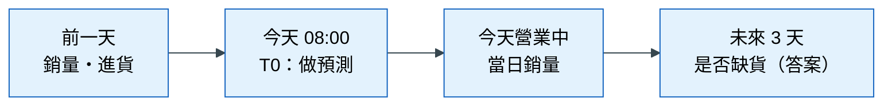
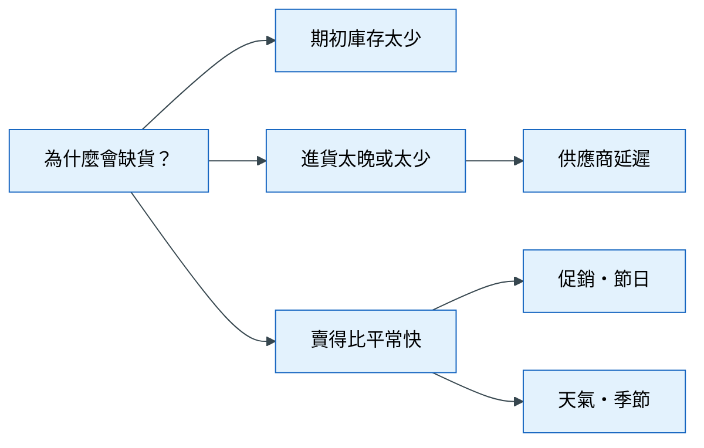

# 第 1 章 問題分析與拆解

> 本章心法：預測任務由**決策**決定，不是由資料決定。先問「誰、在什麼時候、要做什麼決定」，再看資料。

## 學習目標

- 將一個模糊的商業需求，轉換成一份完整的預測任務規格
- 說明什麼是預測時點 T0，並依決策時點推導它
- 選擇符合決策的主指標與基準模型，並說明理由
- 事先訂定停止條件
- 以 MECE 原則把問題拆成可以驗證的小問題

## 本章貫穿案例：連鎖超市的缺貨預警

> 一家連鎖超市有 200 間門市。區經理抱怨：「每週都有熱門商品缺貨，客人買不到就去別家。能不能用資料提早知道哪些商品快缺貨？」

這是一個典型的「模糊需求」：它說出了痛點，但沒有說出要預測什麼、什麼時候預測、預測完要做什麼。本章會一步步把它變成一個可以動手的預測任務。

## 1.1 從決策倒推任務

### 遇到的麻煩

拿到這個需求，最直覺的做法是打開資料庫，看看有哪些欄位，然後挑一個「看起來可以預測」的目標開始建模。例如：資料裡有每天的銷量，那就預測明天的銷量吧。

### 不處理會怎樣

三個月後，你做出一個銷量預測模型，誤差很小。你興奮地交給區經理，他卻說：「我要這個做什麼？我們每天早上 8 點補貨，我想知道的是**哪幾樣東西要緊急調貨**，而且我們一天最多只能處理 20 項。」你的模型預測的是銷量，他要的是一份排序名單；你的模型每天晚上跑，他早上 8 點就要用。模型很準，但沒有人用得上。

這種「做出一個很準但沒人用的模型」，是資料科學專案最常見的失敗方式。問題不在模型，而在一開始就定錯了題目。

### 原理

一個預測，只有在**改變某個人的某個決定**時才有價值。所以定義任務的順序應該反過來：不是從資料出發，而是從決策出發，倒推回去。

> **定義** 預測任務：在某個預測時點，以當下已經知道的資訊，對一個明確定義的對象，估計某個未來的結果，以支援某一個特定的決策。

這個定義裡的每個詞都對應到一個要回答的問題。

### 怎麼做：任務規格表

依序回答下面九個問題。前四個問「決策」，後五個是由決策推導出來的「任務」。

| 問題 | 本案例的答案 | 為什麼要問 |
|---|---|---|
| 誰會用這個預測？ | 門市店長 | 決定結果要用什麼形式呈現 |
| 什麼時候用？ | 每天早上 8 點補貨前 | 決定預測時點 |
| 用來做什麼決定？ | 哪些品項要緊急調貨 | 決定要預測什麼 |
| 一天能處理多少件？ | 約 20 個品項 | 決定評估指標看「前幾名」 |
| 預測時點 T0 | 每天 08:00 | 見 1.2 |
| 分析單位 | 一間門市 × 一個品項 × 一天 | 見 1.3 |
| 目標 | 未來 3 天內是否缺貨（庫存降到 0） | 見 1.3 |
| 主指標 | Precision@20 | 見 1.4 |
| 基準 | 「昨天庫存最低的 20 個品項」 | 見 1.5 |

### 常見錯誤

- 先看資料有什麼欄位，再決定要預測什麼 → 題目被資料綁架
- 跳過「一天能處理多少件」→ 後面選指標時沒有依據
- 業務的數字（容量、成本）由分析師自己猜 → 這些應該由業務單位提供，不知道就寫「待確認」

## 1.2 預測時點 T0

### 遇到的麻煩

缺貨預警的資料裡有一個欄位叫「當日實際銷量」。拿它來預測「未來 3 天會不會缺貨」，效果非常好——今天賣得多，庫存就消耗得快。那可以用嗎？

### 不處理會怎樣

不行。區經理早上 8 點就要拿到名單，但「當日實際銷量」要到晚上關店才知道。訓練時你把它當成輸入，模型表現亮眼；真正上線時，早上 8 點這個欄位還是空的，模型就失靈了。更糟的是，這個問題在驗證階段完全看不出來，因為驗證資料裡這個欄位是有值的。

### 原理：什麼是 T0

> **定義** 預測時點 T0（Time zero，讀作「T 零」）：我們做出預測的那一刻。T0 之前已經被觀察到的資訊可以使用；T0 之後才知道的資訊，一律不能使用。

用一個生活例子說明。氣象預報員在今天晚上 8 點預測明天會不會下雨。他可以用今天的雲圖、氣壓、溫度，但不能用「明天中午的實際雨量」，因為那時候它還不存在。對他來說，T0 就是「今天晚上 8 點」。

在資料分析裡，每一列資料都有自己的 T0。缺貨預警的每一列是「某門市、某品項、某一天」，它的 T0 就是「那一天早上 8 點」。對 3 月 5 日那一列來說，3 月 4 日的銷量可以用，3 月 5 日的銷量不能用。

### T0 由什麼決定

T0 由**決策發生的時間**決定，而不是由「資料什麼時候最完整」決定。

這一點很反直覺。分析師的本能是「資訊越多越好」，所以會想把 T0 往後挪，例如改成「每天晚上關店後」，這樣就能用當日銷量了。但區經理的決策發生在早上 8 點，晚上才產生的名單對他沒有用。

T0 也是一種取捨：T0 越晚，可用的資訊越多，預測越準；但留給人採取行動的時間越少。如果業務需要更晚、更準的預測，正確的做法是**另外定義一個新的預測任務**，而不是偷偷把 T0 往後移。

### 「發生」與「被觀察到」不一樣

判斷一個資訊在 T0 能不能用，要看它**什麼時候被觀察到**，而不是什麼時候發生。例如門市的盤點結果，盤點在月底完成，但資料要隔週才匯入總部系統。對月初的預測來說，上個月的盤點雖然已經「發生」，卻還沒有「被觀察到」，所以不能用。

### 怎麼做：畫一條資料時間線

下面這張圖回答的問題是：**一筆資料從產生到被我們看到，中間經過哪些事件，T0 落在哪裡？** 畫出這條時間線，是判斷每個欄位能不能用的最直接方法。

**怎麼讀這張圖**：時間由左往右走。T0 左邊的方塊（前一天的銷量與進貨）是可以使用的資訊；T0 右邊的方塊，不論和答案多相關，都不能當成輸入。最右邊的「是否缺貨」是我們要預測的答案。檢查任何一個欄位時，就問：「它落在 T0 的左邊還是右邊？」

### 常見錯誤

- 選「資料最完整的時間點」當 T0 → 分數漂亮，上線時那些資訊還不存在
- 只看事件發生的時間，沒看資料何時進入系統
- 想要更準就偷偷把 T0 往後移，而不是另外定義新任務

## 1.3 分析單位與目標

### 遇到的麻煩

「預測缺貨」這句話，至少有三種理解：預測「某間門市明天有沒有任何商品缺貨」、預測「某個商品明天在全國有沒有缺貨」，或預測「某間門市的某個商品，未來 3 天會不會缺貨」。三種題目，需要的資料、模型和用法完全不同。

### 原理

> **定義** 分析單位：資料表裡「一列代表什麼」。
> **定義** 目標變數（target）：我們要預測的那個答案。

分析單位要配合決策。店長決定的是「哪間門市的哪個品項要調貨」，所以分析單位是「門市 × 品項 × 天」。

目標要定義到「任何兩個人照著算，都會得到相同答案」的程度。「會不會缺貨」不夠精確，要寫清楚：

| 要素 | 本案例 | 沒寫清楚會怎樣 |
|---|---|---|
| 門檻 | 庫存降到 0 | 有人用「低於安全庫存」，有人用「等於 0」，答案不同 |
| 時間窗 | T0 之後 3 天內 | 1 天和 7 天是完全不同的題目 |
| 特殊情況 | 品項停售的那幾天不算 | 停售造成的「庫存 0」會被誤當成缺貨 |

### 常見錯誤

- 分析單位和決策對不上（決策是門市層級，資料卻是全國層級）
- 目標沒寫時間窗，不同人算出不同的比例

## 1.4 指標：主指標與業務指標

### 遇到的麻煩

模型做好了，要怎麼說它好不好？最直覺的是「準確率」：猜對的比例。缺貨預警的模型準確率 97%，聽起來很棒。

### 不處理會怎樣

假設每天 1,000 個品項裡只有 30 個會缺貨（3%）。一個「永遠猜不會缺貨」的模型，什麼都沒學，準確率就有 97%——它一個缺貨都沒抓到，對店長完全沒用。

> **定義** 準確率（Accuracy）：猜對的筆數 ÷ 全部筆數。

準確率的問題在於，當我們關心的事件很少見時（這種資料叫「不平衡資料」），只要全部猜「不會發生」就能拿高分。缺貨、詐騙、設備故障、疾病，幾乎都是少見事件。

### 原理：指標要反映決策

店長每天只能處理 20 個品項。他在乎的不是「1,000 個品項整體猜得準不準」，而是「**模型排在最前面的 20 個，有幾個真的會缺貨**」。指標應該直接衡量這件事。

> **定義** Precision@K（前 K 名精確率）：模型排名最前面的 K 筆中，真正是正例的比例。

例子：模型把風險最高的 20 個品項排出來，其中 8 個真的在 3 天內缺貨，Precision@20 = 8 ÷ 20 = 40%。

> **定義** 提升度（Lift）：模型挑出來的命中率 ÷ 隨機亂挑的命中率。

例子：整體缺貨率是 3%，隨機挑 20 個大約只會中 0.6 個；模型挑的 20 個中了 8 個，命中率 40%，Lift = 40% ÷ 3% ≈ 13 倍。「比亂挑好 13 倍」這句話，主管一聽就懂。

> **定義** PR-AUC（Precision-Recall 曲線下面積）：把「門檻從嚴到鬆」每一種情況下的精確率與召回率畫成一條曲線，計算曲線下的面積。數字越大，代表模型越能把真正的正例排在前面。

為什麼還需要 PR-AUC？因為 Precision@20 只看「剛好前 20 名」，如果店長下個月人力增加到 30 項，我們也希望模型依然好用。PR-AUC 衡量的是「整份排序」的品質，比較穩定，適合在實驗時用來比較不同做法。

### 主指標與業務指標

> **定義** 主指標（primary metric）：整個專案事先約定好的「唯一裁判」，每次比較兩個做法，只看這一個數字決定誰贏。
> **定義** 業務指標：把模型表現翻譯成決策者聽得懂的語言，用於溝通，不用於裁決。

為什麼主指標只能有一個？想像一場比賽，事先說好看「總分」，比完之後才有人說「其實應該看犯規次數」。如果允許同時看很多指標，總能找到一個讓自己的做法看起來比較好的數字。事先只指定一個主指標，比較才公平。

本案例的安排：

| 角色 | 指標 | 用途 |
|---|---|---|
| 主指標 | PR-AUC | 每次實驗比較時的裁判 |
| 業務指標 | Precision@20、Lift@20 | 向店長與區經理報告 |

### 怎麼做：依決策型態選指標

| 決策型態 | 適合的指標 | 不要用 | 理由 |
|---|---|---|---|
| 挑出前 K 名處理（少見事件） | PR-AUC、Precision@K、Lift | 準確率 | 決策只看前 K 名 |
| 需要可信的機率（定價、保險） | Log loss、校準曲線 | 只看 AUC | 要的是「機率準不準」，不只是排序 |
| 預測數量（備貨、排班） | MAE（平均絕對誤差）、WAPE | 只看 R² | 決策關心「差了幾件」 |
| 錯一邊代價特別高（漏診） | 指定召回率下的精確率、成本加權指標 | 對稱的指標 | 兩種錯誤代價不同 |

### 常見錯誤

- 用準確率評估少見事件
- 同時看很多指標，挑對自己有利的那個報告
- 實驗做到一半才換主指標

## 1.5 基準模型

### 遇到的麻煩

模型的 PR-AUC 是 0.25。這樣算好嗎？

### 不處理會怎樣

沒有比較對象，0.25 這個數字沒有意義。如果「什麼都不做」也有 0.22，你花三個月做的模型只多了 0.03；如果「什麼都不做」只有 0.03，0.25 就是巨大的進步。沒有基準，就無法回答「這個模型值不值得做」。

### 原理

> **定義** 基準模型（baseline）：一個「完全不用動腦」或極簡單的預測方法，用來當比較的底線。

基準有兩種，回答不同的問題：

| 基準 | 是什麼 | 回答的問題 | 本案例 |
|---|---|---|---|
| 不學習的基準 | 不看任何資料規律的猜法 | 「做模型值得嗎？」 | 每個品項都給相同的分數（等於整體缺貨率） |
| 簡單規則或簡單模型 | 業務現在就在用的規則，或只用原始欄位的模型 | 「我們的努力值得嗎？」 | 「昨天庫存最低的 20 個」 |

第二種基準特別重要。如果店長現在憑經驗「挑庫存最低的」就能抓到大部分缺貨，你的模型至少要明顯贏過這個規則，才有理由取代它。

### 常見錯誤

- 只報告模型分數，不報告基準
- 基準選得太弱（只和「亂猜」比），讓模型看起來比實際有用

## 1.6 停止條件

### 遇到的麻煩

模型做好了，PR-AUC 0.25。再加幾個特徵，變成 0.252；再調一下參數，變成 0.254。要繼續嗎？

### 不處理會怎樣

實驗永遠可以再多做一個，沒有自然的終點。沒有事先約定的話，會發生兩件事：第一，專案無限延長，永遠在「再試一下」；第二，試的次數越多，越有可能「碰巧」試出一個分數比較高的組合，但那只是運氣，換一批資料就消失了。

### 原理

> **定義** 停止條件：專案開始**之前**就寫好的「做到什麼程度就停」。

關鍵在「之前」。看到結果之後才決定要不要停，人很難不被結果影響。事先寫下，就像考試前先決定「考到 80 分就去玩」，而不是一直考到滿意為止。

### 怎麼做：五種常見的停止條件

| 條件 | 白話 | 本案例 | 為什麼需要 |
|---|---|---|---|
| 實驗上限 | 最多做幾次比較 | 最多 30 次 | 試越多次，越容易碰巧試出假的進步 |
| 最小有意義增益 | 進步小於這個門檻，就當作沒進步 | PR-AUC 進步少於 0.005 不算數 | 任何分數都有隨機波動；太小的進步可能只是雜訊，也不值得增加系統複雜度 |
| 連續無進展 | 連續幾輪都沒有穩定的進步就停 | 連續 2 輪 | 代表目前的方向已經走到極限 |
| 截止日 | 時間到就停 | 季底前上線 | 業務決策不會無限等待 |
| 提交門檻 | 達到這個水準才值得上線 | Lift@20 至少 5 倍，且贏過「庫存最低」規則 | 沒達標就不該上線，即使時間到了 |

其中「最小有意義增益」最值得多解釋。假設你把同一個模型用不同的隨機種子跑三次，PR-AUC 分別是 0.250、0.253、0.248，這 0.005 的差距純粹來自隨機性。所以當一個新特徵帶來 0.002 的進步時，你無法分辨它是真的有用，還是運氣好。事先劃一條門檻（分界值），低於門檻的進步一律不算數，就能避免被雜訊騙。

### 常見錯誤

- 沒有停止條件，看到結果才決定要不要繼續
- 最小有意義增益設成 0，任何微小的進步都當成成果
- 時間到了就上線，沒檢查是否達到提交門檻

## 1.7 問題拆解

### 遇到的麻煩

任務定義好了，接下來要找「什麼因素會造成缺貨」。腦力激盪一下，大家想到一堆：促銷、天氣、進貨延遲、節日、競爭對手……清單越來越長，卻不知道從哪裡開始，也不知道有沒有漏掉重要的方向。

### 原理

> **定義** MECE（Mutually Exclusive, Collectively Exhaustive，互斥且窮盡）：分類時，每個分支互不重疊，合起來又沒有遺漏。
> **定義** 議題樹（issue tree）：把一個大問題，按照 MECE 原則一層層拆成可以用資料驗證的小問題。

拆解的好處有兩個：一是確保沒有漏掉重要方向；二是每個小問題都夠具體，可以用一次分組比較或一張圖來驗證。

### 怎麼做：三種拆法

| 方法 | 適用情況 | 案例 |
|---|---|---|
| 公式拆解 | 目標可以寫成算式 | 庫存 = 期初庫存 + 進貨 − 銷售 → 缺貨是因為期初太少、進貨太晚，還是賣太快？ |
| 流程拆解 | 目標是一連串事件的結果 | 訂貨 → 物流配送 → 上架 → 銷售，每一段都可能出問題 |
| 利害關係人拆解 | 結果由多方行為共同決定 | 顧客（需求暴增）、供應商（缺貨）、門市（補貨不及） |

缺貨案例最適合用公式拆解，因為「庫存」本來就是一個加減算式。下面這張圖回答的問題是：**「為什麼會缺貨？」可以從哪幾個互不重疊的方向去找原因？**

**怎麼讀這張圖**：從最左邊的大問題開始，往右每一層都是更具體的原因。第一層的三個分支直接來自「庫存 = 期初 + 進貨 − 銷售」，所以它們互不重疊、合起來也沒有遺漏。第二層只展開了其中兩支，示範如何繼續往下拆；實際工作時，每一支都要拆到「用資料就能驗證」為止，例如「促銷期間的缺貨率是否比平常高」。

拆解時的兩個原則：

- **每層 3–4 個分支**：太多會失去重點，太少可能有遺漏
- **排優先順序**：先驗證「影響大、在 T0 拿得到資料、驗證後能採取行動」的分支

### 常見錯誤

- 分支互相重疊（「促銷」和「節日」放在同一層，但節日常常就有促銷）
- 拆到很細，卻拆出 T0 根本拿不到資料的方向
- 只靠腦力激盪列清單，沒有結構

## 本章小結

- 先有決策，才有任務；用九個問題的任務規格表把需求變成預測任務
- T0 是做預測的那一刻，由決策時間決定；判斷資訊能不能用，看的是「被觀察到」的時間
- 指標要反映決策；少見事件不用準確率；主指標只能有一個，而且要事先決定
- 沒有基準的分數沒有意義；停止條件要在看到結果之前寫好
- 用 MECE 議題樹把問題拆到可以驗證的小問題，再排優先順序

## 習題

1. （概念）為什麼說「T0 越晚，預測越準，但價值不一定越高」？
2. （概念）為什麼主指標要在實驗開始之前決定，而不是做完實驗再選？
3. （應用）為「工廠設備故障預警」填寫完整的任務規格表（九個問題），並畫出資料時間線。
4. （應用）把「為什麼訂閱用戶會取消訂閱？」拆成三層議題樹，並標出哪些葉節點在 T0 可以驗證。
5. （思辨）業務主管希望用準確率當指標，因為「大家都看得懂」。你會怎麼回應？

## 圖文建議

| 圖 | 呈現什麼 | 形式 |
|---|---|---|
| ★ 決策 → 任務轉換畫布 | 左邊是區經理的模糊需求，右邊是九格任務規格表 | 畫布 |
| 資料時間線 | 1.2 的 Mermaid；可加上「當日銷量」被打叉的錯誤示範 | 時間線 |
| 準確率的陷阱 | 1,000 個品項，「全猜不缺貨」得 97% 準確率但抓到 0 個 | 對照圖 |
| 議題樹 | 1.7 的 Mermaid | 樹狀圖 |

## 延伸閱讀

- Umbrex, *Issue Tree Explained*（見[參考文獻](references.md)）
- 本書[術語表](glossary.md)：預測時點 T0、主指標、基準模型、停止條件
