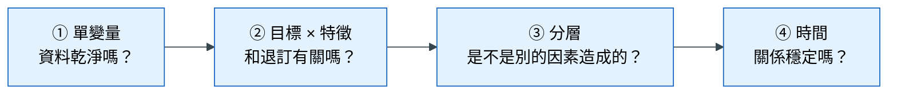
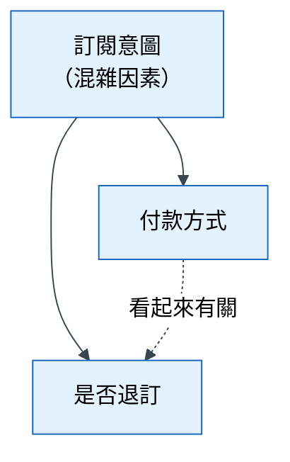

# 第 2 章 探索式資料分析

> 本章心法：EDA 是為了**做決定**而減少不確定，不是為了畫圖。**沒有預期的圖不畫。**

## 學習目標

- 說明 EDA 的目的，以及「探索」與「驗證」兩個階段的差別
- 用「由粗到細四層」的順序檢查資料
- 用 5W1H 找出合理的分析切角，並判斷一個切角好不好
- 用分層比較檢查混雜因素，並說出相關不等於因果的五種陷阱
- 把 EDA 的結果寫成假設卡，並轉換成預測當下拿得到的特徵

## 本章貫穿案例：影音訂閱平台的退訂

> 一個影音訂閱平台有 50 萬名月付會員。行銷團隊想在每個月的帳單日前一週，挑出最可能退訂的會員，送他們一張優惠券。預測時點 T0 是「帳單日前 7 天」，目標是「這位會員在帳單日是否退訂」，整體退訂率約 6%。

任務已經依照第 1 章定義好了。接下來的問題是：**哪些因素和退訂有關？** 這就是探索式資料分析要回答的。

## 2.1 EDA 到底在做什麼

### 遇到的麻煩

拿到資料，很多人的第一個動作是：把每個欄位都畫一張圖，每兩個欄位都算一次相關係數，產出一份 50 頁的報告。看起來很認真，但讀完之後，沒有人知道下一步要做什麼。

### 不處理會怎樣

這種「先畫再說」的做法有兩個問題。第一，**效率很低**：大部分圖不會影響任何決定。第二，**容易被巧合騙**：如果你看了 100 個比較，即使資料完全沒有規律，也會有幾個比較「看起來」有明顯差異，純粹是隨機造成的。你會很自然地挑出那幾個，替它們編出一個合理的故事。

### 原理

> **定義** 探索式資料分析（Exploratory Data Analysis, EDA）：在建模之前，透過統計與圖表了解資料的樣貌、品質與規律，目的是減少不確定性，以便做出後續的決定（例如要做哪些特徵、要排除哪些資料）。

EDA 的價值不在圖本身，而在**它改變了什麼決定**。一張圖如果不管結果長怎樣，你下一步都會做同樣的事，那它就不值得畫。

EDA 其實包含兩個階段，混在一起做就容易出錯：

| 階段 | 問的問題 | 心態 | 產出 |
|---|---|---|---|
| 探索 | 資料長什麼樣？哪裡怪怪的？ | 開放、好奇 | 資料品質問題、值得追查的線索 |
| 驗證 | 我的猜測對不對？ | 嚴謹、懷疑 | 支持、推翻或證據不足的結論 |

探索階段可以自由看，但看到的東西只能算「線索」。要把線索變成結論，必須進入驗證階段：先寫下預期，再用資料檢查。

### 先寫預期

這是本章最重要的一個習慣。在跑任何比較之前，先寫下：「我預期月繳超過 400 元的會員，退訂率約是其他會員的 1.5 倍。」

為什麼要先寫？因為沒有預期，你看到任何結果都會覺得「果然如此」：退訂率高了 1.5 倍，「果然貴的方案容易退訂」；結果只高 1.05 倍，「果然價格不是主因」。有了事先寫下的預期，結果才有機會**推翻**你，而被推翻的時候，才是真正學到東西的時候。

## 2.2 由粗到細的四層檢查

### 遇到的麻煩

想直接回答「什麼因素造成退訂」，卻發現「會員年資」欄位裡有負數，「方案價格」有一半是空的。

### 不處理會怎樣

如果跳過基本檢查直接分析，你可能得出「年資越短越容易退訂」的結論，但其實是因為某一批資料的年資欄位填錯了。在髒資料上做的分析，結論再漂亮也不可信。

### 原理

EDA 要由粗到細，一層一層往下。每一層都建立在前一層的基礎上：資料品質沒問題，才能看關聯；看到關聯，才需要檢查是不是被別的因素造成；確認關聯成立，才需要檢查它隨時間穩不穩定。

下面這張圖回答的問題是：**EDA 應該依什麼順序進行？** 它把四層的先後關係畫出來，提醒你不要跳步。

**怎麼讀這張圖**：從左往右，每一層回答一個問題。只有前一層的答案是「沒問題」，才進到下一層。例如第 ① 層發現年資有負數，就要先處理資料，而不是直接跳到第 ② 層比較退訂率。

### 怎麼做

| 層 | 問什麼 | 典型做法 | 本案例會發現什麼 |
|---|---|---|---|
| ① 單變量 | 每個欄位長什麼樣？ | 看分布、缺失率、不同值的數量、最大最小值 | 年資有負數；方案價格缺失集中在某個月 |
| ② 目標 × 特徵 | 哪些欄位和退訂有關？ | 依類別分組算退訂率；把數值切成幾段再算退訂率 | 月付金額高的退訂率較高 |
| ③ 分層 | 這個關聯是不是被別的因素造成的？ | 在第三個因素的每一層內，再比較一次 | 控制「是否有年約」後，價格的影響變小 |
| ④ 時間 | 關聯隨時間穩定嗎？ | 依月份畫退訂率與特徵的變化 | 某次漲價後，退訂率整體跳升 |

### 常見錯誤

- 跳過第 ① 層，在髒資料上找規律
- 停在第 ② 層，把看到的關聯直接當成原因
- 沒做第 ④ 層，沒發現規律只在某段時間成立

## 2.3 切角：從哪些角度看資料

### 遇到的麻煩

第 ② 層要「依類別分組算退訂率」，但資料有 40 個欄位，可以分組的方式成千上萬。該從哪裡切起？

### 原理

> **定義** 切角：一個分組比較的角度，例如「依方案類型比較退訂率」。

好的切角有兩個來源。第一個來源是**第 1 章的議題樹**：議題樹的每一個葉節點，都是一個天然的切角。例如議題樹裡有「價格太貴」這個分支，對應的切角就是「依月付金額比較退訂率」。

第二個來源是 **5W1H**，用來檢查議題樹有沒有遺漏的角度。任何一個事件，都可以從這六個方向去問：

| 維度 | 問題 | 本案例的切角 |
|---|---|---|
| Who | 是誰？ | 新會員 vs 老會員、年齡層、是否家庭方案 |
| What | 用什麼？ | 方案類型、常看的內容類別 |
| Where | 在哪裡？ | 地區、主要使用的裝置 |
| When | 什麼時候？ | 加入的月份、距離上次觀看幾天 |
| How | 怎麼使用？ | 付款方式、是否自動續約 |
| How much | 用多少？ | 月付金額、每週觀看時數 |

先從議題樹挑，再用 5W1H 補漏。

### 怎麼判斷一個切角好不好

不是每個切角都值得做。一個好切角要符合四個條件：

| 條件 | 意思 | 不符合會怎樣 |
|---|---|---|
| 有預期 | 跑之前寫得出「我預期 A 組比 B 組高」 | 看到什麼都像證據 |
| 樣本夠 | 每組至少有數百筆資料 | 小組的比例會亂跳，差異可能只是運氣 |
| 可行動 | 結果會改變特徵設計或業務作法 | 做了也不會用 |
| T0 拿得到 | 要變成特徵時，這個資訊在預測當下存在 | 只能用來理解原因，不能用來預測 |

關於第四點要特別說明：理解「為什麼會退訂」時，可以使用 T0 之後才知道的資訊。例如「退訂當月有沒有打電話客訴」，對理解原因很有幫助。但它在帳單日前 7 天還沒發生，不能當成預測的輸入。這種情況要在分析中清楚標註「T0 不可得」，後面 2.6 節會說明怎麼處理。

## 2.4 相關不等於因果

### 遇到的麻煩

第 ② 層發現：使用「信用卡付款」的會員，退訂率只有 4%；使用「超商代碼繳費」的會員，退訂率高達 15%。結論很誘人：「推廣信用卡付款，就能降低退訂。」

### 不處理會怎樣

行銷團隊花了大筆預算推廣信用卡綁定，退訂率卻沒有下降。為什麼？因為付款方式本身不是原因。用超商繳費的會員，多半是「只想試看一個月」的人，他們本來就沒打算長期訂閱；而綁信用卡的會員，本來就是打算長期使用的人。付款方式和退訂率都是被「訂閱意圖」這個因素影響的。

### 原理

> **定義** 混雜因素（confounder）：同時影響「原因」和「結果」的第三個因素，讓兩者看起來有關，但其實沒有因果關係。

經典例子：冰淇淋銷量和溺水人數高度相關，但吃冰淇淋不會讓人溺水。兩者都是因為「天氣熱」：天氣熱，買冰淇淋的人多，去游泳的人也多。

> **定義** 分層比較（stratification）：在混雜因素的每一個層級內，分別比較原因和結果的關係。

如果懷疑「訂閱意圖」是混雜因素，就把會員依「是否在第一個月就看完 5 部以上影片」（代表意圖的指標）分成兩層，在每一層內各自比較兩種付款方式的退訂率。如果在每一層內差異都消失了，代表原本的關聯主要來自混雜因素。

下面這張圖回答的問題是：**為什麼兩件事看起來有關，卻不一定是因果？** 它把混雜因素的結構畫出來。

**怎麼讀這張圖**：實線箭頭代表真正的影響方向：「訂閱意圖」同時影響了「付款方式」和「是否退訂」。虛線代表我們在資料中看到的關聯，它不是直接的因果，而是因為兩者有共同的源頭。分層比較的作用，就是把最上面那個方塊「固定住」，看虛線還在不在。

### 相關不等於因果的五種陷阱

| 陷阱 | 意思 | 本案例的例子 | 怎麼檢查 |
|---|---|---|---|
| 混雜 | 第三個因素同時造成兩者 | 訂閱意圖影響付款方式與退訂 | 分層比較 |
| 反向因果 | 其實是結果造成原因 | 「很少登入的人容易退訂」——也可能是已經決定退訂的人才不登入 | 看時間先後 |
| 選擇偏差 | 只看到被篩選過的樣本 | 只分析「填過滿意度問卷」的會員，但會填問卷的人本來就比較投入 | 問「哪些人沒進到資料裡？」 |
| Simpson 悖論 | 整體趨勢與每一組的趨勢相反 | 整體看家庭方案退訂率較高，但在每個價格帶內，家庭方案的退訂率都比較低（因為家庭方案多屬高價帶） | 分層後重算 |
| 生態謬誤 | 把群體層級的關係套到個人 | 「退訂率高的地區，平均年齡較低」不代表「年輕人比較容易退訂」 | 回到個人層級驗證 |

即使分層之後關聯仍然存在，也只代表「排除了這一個混雜因素」，不代表已經證明因果。要證明因果，通常需要實驗（例如隨機發放優惠券，比較兩組的退訂率）。不過對預測任務來說，**相關本身就有預測價值**——只要它在預測當下拿得到，而且關係穩定。因果的問題，在「用預測結果採取行動」時才變得關鍵。

### 常見錯誤

- 只做分組、不做分層，把混雜當成因果
- 分層後關聯仍在，就宣稱「證明了因果」
- 只看整體數字，沒有發現 Simpson 悖論

## 2.5 假設卡：把 EDA 的結果寫下來

### 遇到的麻煩

做了一下午的分析，有一堆圖和數字，但隔天回頭看，已經想不起來哪張圖是要驗證什麼，結論又是什麼。

### 原理

EDA 的產出不應該是一堆圖，而是一張張**假設卡**。每張卡記錄一個假設從預期到結論的完整過程，讓自己和別人都能看懂、追溯。

### 怎麼做

| 欄位 | 寫什麼 | 本案例範例 |
|---|---|---|
| 假設 | X 會讓 Y 變高 | 月付金額越高，越容易退訂 |
| 預期 | 跑之前寫下的數字 | 高價方案退訂率約是低價的 1.5 倍 |
| 分組結果 | 實際數字與樣本數 | 高價 8.1%（n=120,000）vs 低價 5.2%（n=380,000），1.56 倍 |
| 分層結果 | 控制混雜因素後是否仍成立 | 控制「是否有年約」後，倍數降為 1.2 倍 |
| 競爭解釋 | 還有什麼也能解釋這個結果 | 高價方案的會員比較常是「為了某部劇才加入」 |
| 結論 | 支持 / 推翻 / 證據不足 | 支持，但影響比預期小 |
| T0 可用的特徵 | 預測當下能用的版本 | 月付金額、是否有年約 |

被推翻或證據不足的假設，也要留下來。它們告訴你「這條路不用再走了」，省下後面做特徵的時間。

## 2.6 從機制到特徵

### 遇到的麻煩

分析發現：退訂前一個月「打過客服電話」的會員，退訂率高達 40%。這是非常強的訊號。但問題是，帳單日前 7 天做預測時，你不知道這位會員接下來會不會打客服電話。

### 原理

這是 EDA 最常見的情況：**最能解釋結果的因素，往往在預測當下還不存在**。這時候不能直接用它，但可以找一個「代理」。

> **定義** 代理特徵（proxy feature）：真正的原因在 T0 拿不到時，用一個 T0 拿得到、又和原因高度相關的替代品。

| T0 拿不到的機制 | 為什麼會造成退訂 | T0 拿得到的代理特徵 |
|---|---|---|
| 接下來會打客服電話 | 對服務不滿 | 過去 30 天播放失敗的次數；過去 90 天客服紀錄 |
| 接下來不再觀看 | 失去興趣 | 最近 7 天觀看時數 vs 過去平均 |

這就是 EDA 和特徵工程的銜接點：EDA 找出「為什麼」，特徵工程把「為什麼」翻譯成預測當下拿得到的數字（第 4 章）。

### 常見錯誤

- 把 EDA 裡最強的關聯直接當成特徵，忘了檢查它在 T0 是否存在
- 用 T0 之後的欄位理解機制後，沒有標註，後來誤用

## 本章小結

- EDA 的目的是減少不確定性以做出決定；不會改變任何決定的圖不必畫
- 先寫預期，再看結果；探索得到的是線索，驗證得到的才是結論
- 依「單變量 → 目標 × 特徵 → 分層 → 時間」四層由粗到細檢查
- 切角來自議題樹與 5W1H；好切角要有預期、樣本夠、可行動、T0 拿得到
- 相關不等於因果；分層比較可以排除混雜，但不能證明因果
- EDA 的產出是假設卡；T0 拿不到的機制要轉成代理特徵

## 習題

1. （概念）為什麼「先畫一百張圖，再找故事」容易得出錯誤結論？
2. （概念）分層比較之後關聯仍然存在，為什麼仍不能說證明了因果？
3. （應用）「週末加入的會員退訂率比較高」，請提出兩個競爭解釋，並說明各自要怎麼分層檢查。
4. （應用）某醫院發現「住院期間換過病房的病人，出院後再入院率較高」，但換病房是住院中才發生的事。請提出兩個入院當下就拿得到的代理特徵。
5. （思辨）如果預測模型只需要「相關」就能預測得準，我們為什麼還要在乎因果？

## 圖文建議

| 圖 | 呈現什麼 | 形式 |
|---|---|---|
| ★ 四層檢查 | 2.2 的 Mermaid | 流程圖 |
| 混雜因素結構 | 2.4 的 Mermaid；可另畫冰淇淋與溺水的生活版 | 因果圖 |
| 分組 vs 分層 | 同一個關聯，分層前差很多、分層後差異縮小 | 並排長條圖 |
| Simpson 悖論 | 整體趨勢向上、每一組趨勢向下 | 散佈圖 |
| 假設卡 | 一張填好的卡 | 卡片 |

## 延伸閱讀

- *A Grammar of Hypotheses for Visualization, Data, and Analysis*（見[參考文獻](references.md)）
- John W. Tukey, *Exploratory Data Analysis*
- 本書[術語表](glossary.md)：混雜因素、分層比較、Simpson 悖論、生態謬誤
