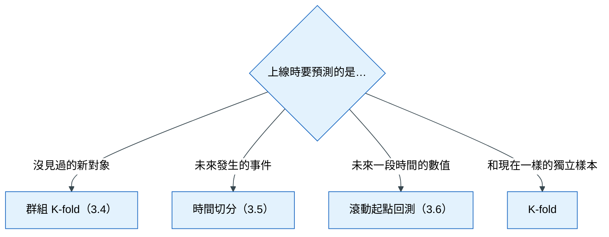
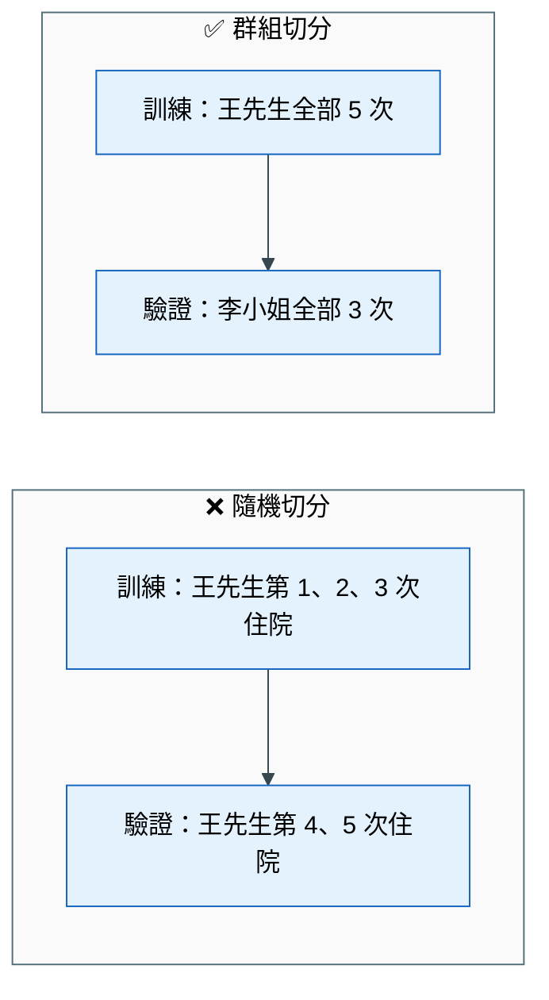
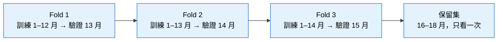

# 第 3 章 資料切分與洩漏

> 本章心法：驗證要**模擬上線那一刻**。一句話擋下大多數洩漏：**「預測那一刻，這個值存在嗎？」**

## 學習目標

- 用「考試」的比喻說明訓練集、驗證集、保留集的用途，以及保留集為什麼只能用一次
- 依上線情境選擇切分方式，並說明為什麼新的實體要用群組切分、未來的事件要用時間切分
- 說明滾動起點回測與季節性樸素預測的做法
- 用同 fold 配對比較判斷一個進步是不是穩定
- 辨識五種資料洩漏，說明擾動測試與對抗驗證的原理

## 本章貫穿案例

本章用兩個案例，因為不同的上線情境需要不同的切分方式：

> **案例 A：醫院再入院預測。** 病人出院時，預測他 30 天內會不會再次住院，讓護理師對高風險病人加強出院衛教。同一位病人可能住院很多次。
>
> **案例 B：門市銷量預測。** 每週日晚上，預測一間門市下週一到週日每天的銷量，讓店長排班與訂貨。

## 3.1 為什麼要把資料切開

### 遇到的麻煩

你用全部資料訓練了一個模型，再用同樣的資料檢查它，準確得驚人。

### 不處理會怎樣

這就像學生用考古題練習，再用**同一份考古題**當期末考，當然考滿分。但這個分數完全不能說明他學會了沒有——他可能只是把答案背下來了。模型也一樣，用訓練過的資料檢查它，看不出它在新資料上的表現。

### 原理：三份資料，三種用途

用「準備考試」來比喻：

| 名稱 | 白話 | 考試比喻 | 可以看幾次 |
|---|---|---|---|
| 訓練集（training set） | 模型拿來學習的資料 | 課本與習題 | 無限次 |
| 驗證集（validation set） | 用來比較不同做法，挑出最好的那一個 | 模擬考 | 很多次 |
| 保留集（holdout set，又稱測試集） | 最後只看一次，估計上線表現 | 正式考試 | **一次** |

為什麼要分成三份，而不是兩份？因為「挑選」本身也會造成偏差。假設你試了 50 種做法，每一種都在驗證集上打分數，最後挑出分數最高的那一個。這個最高分有一部分是真實力，也有一部分是「剛好在這份驗證集上運氣好」。所以需要一份**從來沒有參與挑選**的資料，在最後給一個誠實的分數。

### 為什麼保留集只能看一次

如果你看了保留集的分數，覺得不夠好，回頭修改模型，再看一次分數——這時候保留集就參與了挑選，它變成了另一份驗證集，不再能代表上線表現。就像學生偷看了正式考卷，回去準備後再考一次，這個分數已經不能說明他的真實程度。

實務上的做法是：保留集交給一個人保管，只有在專案最後、決定要上線時才打開一次。

### 常見錯誤

- 用訓練資料評估模型
- 反覆看保留集的分數來調整模型
- 只切成訓練與測試兩份，用測試集挑模型

## 3.2 交叉驗證

### 遇到的麻煩

驗證集只有一份，模型 A 拿 0.30、模型 B 拿 0.31。但如果換一份驗證集，結果會不會反過來？

### 原理

> **定義** 交叉驗證（Cross-validation，簡稱 CV）：把資料輪流切成幾份，每次拿其中一份當驗證集、其餘當訓練集，重複幾次，看每一次的結果與平均。
> **定義** Fold（折）：交叉驗證裡的「一次」。5-fold 交叉驗證，就是輪流考 5 次。

只考一次模擬考，可能剛好題目簡單或困難；考五次，比較能看出真正的實力，也能看出成績穩不穩定。

> **定義** K-fold 交叉驗證：把資料**隨機**分成 K 份，輪流當驗證集。

K-fold 的前提是「每一列資料彼此獨立，而且上線時遇到的資料和現在長得一樣」。這個前提很多時候不成立，下面三節會說明怎麼辦。

## 3.3 切分方式由上線情境決定

### 遇到的麻煩

隨機切分最簡單，scikit-learn 一行就做完。為什麼不是所有問題都用它？

### 原理

驗證的目的，是**估計模型上線後的表現**。所以驗證集要盡量模擬「上線時會遇到的資料」。上線時遇到的是什麼，決定了該怎麼切。

下面這張圖回答的問題是：**面對一個新任務，該選哪一種切分方式？** 只要回答「上線時要預測的是什麼」，就能找到對應的方法。

**怎麼讀這張圖**：從最上面的問題出發，選擇最符合你上線情境的那一條路。一個任務可能同時符合兩條（例如「未來的新病人」），這時要兩個條件都滿足：同一位病人不能跨兩邊，而且驗證資料的時間要在訓練資料之後。

## 3.4 新的對象：群組 K-fold

### 遇到的麻煩

案例 A 的再入院資料裡，一位病人可能住院 5 次，資料裡就有 5 列。用隨機 K-fold 切分，這位病人的 3 次住院可能在訓練集、2 次在驗證集。

### 不處理會怎樣

一步一步看會發生什麼：

1. 訓練時，模型看到這位病人的 3 次住院紀錄，學到他的特徵：72 歲、有糖尿病、住在偏遠地區、過去常常再入院。
2. 驗證時，模型遇到同一位病人的另外 2 次住院。因為它「認識」這位病人，猜得非常準。
3. 驗證分數因此虛高。
4. 上線後，模型要預測的大多是**從沒見過的新病人**，沒有這種「認識的人」可以佔便宜，分數就掉下來了。

這就像考試時，考題是你在習題本上看過的原題，你考得很好，但遇到新題目就不會了。

### 原理

> **定義** 群組 K-fold（Group K-fold）：以「群組」（例如病人）為單位切分，同一個群組的所有資料只能**整組放在同一邊**。

這樣一來，驗證集裡的每一位病人，模型在訓練時都沒見過，正好模擬上線時遇到新病人的情況。一句話：**上線要面對新的人，驗證就要用新的人來考。**

下面這張圖回答的問題是：**隨機切分和群組切分，差在哪裡？**

**怎麼讀這張圖**：左邊是錯誤示範，同一位王先生同時出現在訓練與驗證兩邊，模型在驗證時其實是在「認人」。右邊是正確示範，王先生整組在訓練集，驗證集換成模型從沒見過的李小姐。要記住的一點是：**切分的單位，是上線時「新出現」的那個東西。**

### 怎麼做

| 情境 | 群組是什麼 |
|---|---|
| 預測新病人 | 病人 ID |
| 預測新客戶會不會違約 | 客戶 ID |
| 預測新門市的業績 | 門市 ID |
| 預測新機台會不會故障 | 機台 ID |

### 常見錯誤

- 同一個對象的多筆資料散在訓練與驗證兩邊
- 群組選錯（應該以病人分群，卻以住院紀錄分群）

## 3.5 未來的事件：時間切分

### 遇到的麻煩

案例 A 換個角度：醫院要用模型預測**下個月**出院病人的再入院風險。如果用隨機切分，訓練集裡會有 12 月的資料，驗證集裡會有 3 月的資料。

### 不處理會怎樣

模型等於拿「未來」去預測「過去」。例如 12 月爆發流感，大量病人再入院，模型從訓練資料學到「冬天再入院率高」；驗證時剛好用它來預測同年 3 月，猜得很準。但上線時，模型不可能事先知道下一次流感什麼時候來。

時間有方向，而且世界會變：制度會改、病人組成會變、季節會循環。隨機切分把這些變化全部打散，讓驗證分數過度樂觀。

### 原理

> **定義** 時間切分：用比較早的資料訓練，用比較晚的資料驗證，模擬「用過去預測未來」。
> **定義** 擴張視窗（expanding window）：交叉驗證的每一次，訓練資料都從起點開始，並且比上一次多一段時間。

用具體月份說明，假設有 15 個月的資料：

| Fold | 訓練資料 | 驗證資料 |
|---|---|---|
| 第 1 次 | 第 1–12 個月 | 第 13 個月 |
| 第 2 次 | 第 1–13 個月 | 第 14 個月 |
| 第 3 次 | 第 1–14 個月 | 第 15 個月 |
| 保留集 | — | 第 16–18 個月（最後才看一次） |

每一次驗證，模型都只能看到驗證月份「之前」的資料，和上線時的處境完全一樣。之所以叫「擴張」，是因為訓練資料一次比一次長，就像實務上每個月都會累積更多歷史資料。

下面這張圖回答的問題是：**擴張視窗的三次驗證，訓練與驗證的時間範圍各是什麼？**

**怎麼讀這張圖**：從左往右，每一個方塊是一次驗證。注意兩件事：第一，每個方塊裡箭頭都是從早指向晚，永遠用過去預測未來；第二，訓練範圍越來越長。最右邊的保留集排在所有驗證月份之後，因為它代表「真正的未來」。

### 常見錯誤

- 時間性的資料用隨機切分
- 只切一次時間點，沒有做多個 fold，無法判斷穩定性

## 3.6 未來一段時間的數值：滾動起點回測

### 遇到的麻煩

案例 B 的門市銷量預測，要在每週日晚上預測**下週七天每一天**的銷量。這和前面不同：我們要預測的不是「是或否」，而是一整段未來的數字。

> **定義** 預測步數 h（horizon）：要往未來預測幾期。案例 B 每次預測 7 天，h = 7。

### 原理：滾動起點回測

> **定義** 滾動起點回測（rolling-origin backtest）：假裝站在過去的某一天（起點），只用那天以前的資料，預測接下來 h 期，再和實際值比較；然後把起點往後移，再做一次。

「回測」這個詞來自投資：要評估一個交易策略，就拿歷史資料重演一遍，看看「如果當時照這個方法做，結果會如何」。

用案例 B 說明（h = 7）：

| 第幾次 | 起點（假裝現在是這天晚上） | 可以用的資料 | 預測並比較 |
|---|---|---|---|
| 1 | 3 月 3 日（週日） | 3 月 3 日以前 | 3 月 4 日–3 月 10 日 |
| 2 | 3 月 10 日（週日） | 3 月 10 日以前 | 3 月 11 日–3 月 17 日 |
| 3 | 3 月 17 日（週日） | 3 月 17 日以前 | 3 月 18 日–3 月 24 日 |

每一次的處境，都和真正上線時「週日晚上要預測下週」一模一樣。最後把每一次的誤差平均起來，就是模型的評估結果。

### 原理：季節性樸素預測

做時間序列預測，第 1 章提到的「基準模型」要特別選。最常用的是：

> **定義** 季節性樸素預測（seasonal naive）：用上一個週期同一時間的值當預測。例如「下週一的銷量 = 這週一的銷量」。

為什麼用它當基準？因為很多序列都有明顯的週期：週末客人多、月初發薪後消費高。一個連「週期」都抓不到的複雜模型，可能還輸給這個最簡單的猜法。

| 日期 | 這週實際銷量 | 下週的季節性樸素預測 |
|---|---|---|
| 週一 | 120 | 120 |
| 週六 | 310 | 310 |
| 週日 | 280 | 280 |

如果你的模型在回測中，誤差沒有明顯小於季節性樸素預測，代表它沒有學到比「照抄上週」更多的東西。

### 常見錯誤

- 只用一個起點做評估，結果可能剛好遇到特殊的一週
- 沒有和季節性樸素預測比較，就宣稱模型有效

## 3.7 同 fold 配對比較：進步是真的嗎

### 遇到的麻煩

用時間切分做了 3 次驗證，做法 A 的平均分數 0.300，做法 B 的平均分數 0.310。B 比較好嗎？

### 不處理會怎樣

看每一次的分數：

| Fold | 做法 A | 做法 B | B − A |
|---|---|---|---|
| 第 13 月 | 0.400 | 0.440 | +0.040 |
| 第 14 月 | 0.250 | 0.245 | −0.005 |
| 第 15 月 | 0.250 | 0.245 | −0.005 |
| 平均 | 0.300 | 0.310 | +0.010 |

B 的平均比較高，但它只在第 13 月大贏，其他兩個月其實都輸。平均數被一個月份帶著走了。如果上線後的月份比較像第 14、15 月，B 反而比較差。

另外注意：三個月份之間的分數差很多（0.40 vs 0.25），這是因為不同月份的難度不同，例如某個月的再入院率特別高。這種「月份之間的差異」通常遠大於「兩個做法之間的差異」，所以只比平均很容易被月份難度蓋過。

### 原理

> **定義** 同 fold 配對比較（paired fold comparison）：在**同一次驗證**上比較兩個做法，看新做法是不是每一次都贏。

生活例子：比較兩雙跑鞋，不要讓一個人在晴天穿 A 跑、另一個人在雨天穿 B 跑；而是同一個人、同一天、同一條路，兩雙各跑一次。這樣差異才來自鞋子本身。

> **定義** 穩健的增益（robust gain）：新做法在**每一個 fold** 都進步，而且平均進步幅度大於「各 fold 進步幅度的波動」。

### 怎麼做

| 情況 | 判斷 |
|---|---|
| 每個 fold 都進步，平均進步大於波動 | 穩健的進步，可以採用 |
| 平均進步，但有 fold 退步 | 不能宣稱有效，可能只是某段時間剛好有利 |
| 某一次突然大幅進步 | 先懷疑洩漏（見 3.8） |

### 常見錯誤

- 只比平均分數
- 把「每一次都進步」當成「一定合法」——洩漏的特徵也會每一次都進步

## 3.8 資料洩漏

### 遇到的麻煩

新加了一個特徵，再入院預測的分數從 0.30 跳到 0.65，而且每一個 fold 都大幅進步。

### 不處理會怎樣

這個特徵是「出院後 30 天內的門診次數」。再入院的病人，當然常常有門診紀錄。但病人出院的那一刻，未來 30 天的門診還沒發生。模型上線後，這個欄位永遠是空的，分數會崩回原點，而且在上線前你完全不會發現。

### 原理

> **定義** 資料洩漏（data leakage）：訓練模型時，不小心用到了上線時拿不到的資訊。

洩漏最危險的地方在於：它會讓驗證分數變好，而且每一個 fold 都變好。所以配對比較擋不住洩漏，必須另外檢查。

### 五種洩漏

| 類型 | 故事 | 防法 |
|---|---|---|
| **目標洩漏** | 用「出院後 30 天內的門診次數」預測再入院。這個欄位本身就是結果的一部分 | 每個欄位都標記「在 T0 之前或之後才知道」 |
| **時間洩漏** | 算「病人過去的平均住院天數」時，用了全部資料的平均，包含這次住院之後的紀錄 | 歷史統計只用 T0 之前的資料，並且排除這一筆自己 |
| **群組洩漏** | 同一位病人的不同住院紀錄，分散在訓練和驗證兩邊（見 3.4） | 群組切分 |
| **前處理洩漏** | 先用全部資料算平均數來補缺失值、做標準化，然後才切分。驗證資料的資訊已經混進訓練過程 | 先切分，所有前處理只用訓練資料計算 |
| **驗證污染** | 反覆看保留集的分數調整模型；或在全部資料上先挑選特徵，再做交叉驗證 | 保留集只看一次；特徵挑選也要在每個 fold 內進行 |

其中第四種最容易被忽略。補缺失值用的平均數、標準化用的平均數與標準差，都是從資料「學」來的。如果用全部資料計算，驗證集的資訊就已經偷偷進入了訓練過程。正確做法是只用訓練資料計算這些數字，再套用到驗證資料。

### 洩漏的警訊

- 加了一兩個特徵，分數就突然大跳升
- 某一個特徵的重要程度，遠遠超過其他所有特徵
- 驗證分數和保留集分數的差距越來越大
- 特徵名稱裡有「實際」「最終」「結果」「之後」這類字眼

### 常見錯誤

- 看到每個 fold 都進步就宣布成功，沒有問「預測那一刻這個值存在嗎？」
- 只用欄位名稱判斷，沒有檢查計算過程

## 3.9 擾動測試：用程式抓洩漏

### 遇到的麻煩

有些洩漏藏在計算過程裡。例如一個叫「病人歷史再入院率」的特徵，名稱看起來完全合法，但程式在計算時不小心用到了 T0 之後的紀錄。光看名稱，看不出問題。

### 原理

> **定義** 擾動測試（perturbation test）：故意竄改「T0 之後才會知道的資料」，然後重新計算特徵，檢查特徵值有沒有跟著改變。

邏輯很直接：一個合法的特徵只用了過去的資訊，所以未來的資料不論怎麼改，它都不應該變。如果它變了，就證明它偷看了未來。

生活例子：懷疑一位學生作弊偷看答案卷，就偷偷把答案卷換成另一份。如果他的答案跟著變了，就證明他有偷看。

### 怎麼做

| 步驟 | 做什麼 |
|---|---|
| 1 | 選一個時間切點，切點之後的資料視為「未來」 |
| 2 | 竄改未來的資料：把數值打亂，或把事件時間往更晚的地方移 |
| 3 | 重新計算所有特徵 |
| 4 | 檢查切點之前的資料列：特徵值必須和竄改前**完全一樣** |
| 5 | 另外寫一個故意洩漏的特徵，確認測試真的抓得到它 |

第 2 步要注意：未來事件只能往**更晚**移，不能往前移。往前移會讓原本在未來的事件跑到過去，讓合法的歷史特徵也跟著改變，造成誤判。

## 3.10 分布漂移與對抗驗證

### 遇到的麻煩

模型沒有洩漏，交叉驗證分數也很穩定。上線三個月後，表現卻明顯變差。

### 原理

> **定義** 分布漂移（distribution shift）：訓練時的資料和上線時的資料「長得不一樣」。

例子：醫院在今年導入新的出院衛教流程，再入院率整體下降；或是醫院開始收治更多高齡病人，病人組成改變。用舊資料訓練的模型，面對新的情況就不準了。這不是模型做錯了什麼，而是世界變了。

### 對抗驗證：如何檢查漂移

> **定義** 對抗驗證（adversarial validation）：訓練一個「分辨器」，讓它猜一筆資料來自「訓練期」還是「上線期」。

做法是把訓練期的資料標成 0、上線期（或保留集）的資料標成 1，訓練一個分類模型去分辨，再看它分得多準。分得準不準，用 AUC 來衡量（AUC 是 0.5 到 1 之間的數字，0.5 代表跟亂猜一樣，1 代表完全分得出來）。

| 分辨器的 AUC | 意思 | 該怎麼辦 |
|---|---|---|
| 約 0.5 | 分不出來，兩期資料長得很像 | 驗證分數大致可信 |
| 0.6–0.8 | 有些差異 | 檢查是哪些欄位造成的 |
| 接近 1 | 一猜就中，兩期資料差很多 | 驗證分數可能高估上線表現，要找出原因 |

對抗驗證還有一個附帶好處：分辨器最依賴的那些欄位，就是「最會隨時間改變」的欄位。例如分辨器最依賴「資料建立日期」或「累計就診次數」，代表這些欄位的值會隨時間一直變大，上線時一定會超出訓練時的範圍。這類欄位要考慮改成比率，或改用近期的時間窗。

### 常見錯誤

- 以為交叉驗證穩定，上線就一定穩定
- 使用會隨時間一直增加的欄位（年份、累計次數）當特徵

## 本章小結

- 訓練集用來學、驗證集用來挑、保留集只在最後看一次
- 切分方式由上線情境決定：新的對象用群組切分；未來的事件用時間切分；未來一段時間的數值用滾動起點回測，並和季節性樸素預測比較
- 判斷進步要用同 fold 配對比較，每一次都進步才算穩健
- 穩健不等於合法；五種洩漏都要防，擾動測試能抓出藏在計算過程裡的洩漏
- 世界會變；用對抗驗證檢查訓練期與上線期的資料是否一致

## 習題

1. （概念）為什麼看過保留集的分數再回頭修改模型，保留集就失去意義？
2. （概念）為什麼月份之間的分數差異大，會讓「只比平均」變得不可靠？
3. （應用）銀行要預測「新申請的客戶」會不會違約，資料中同一位客戶可能有多次申請紀錄，而且銀行每個月都要用模型。請設計切分方式，並說明理由。
4. （應用）「病人過去的平均住院天數」為什麼可能洩漏？請描述安全的計算方式。
5. （思辨）一個新特徵讓 3 個 fold 都大幅進步，你會先做哪些檢查，再決定要不要採用？

## 圖文建議

| 圖 | 呈現什麼 | 形式 |
|---|---|---|
| ★ 隨機切分 vs 時間切分 | 隨機切分讓未來的資料跑進訓練集 | 錯誤 vs 正確並排時間軸 |
| 考試比喻 | 課本、模擬考、正式考試對應三份資料 | 插圖 |
| 切分方式決策樹 | 3.3 的 Mermaid | 決策樹 |
| 群組切分 | 3.4 的 Mermaid | 錯誤 vs 正確並排 |
| 擴張視窗 | 3.5 的 Mermaid，也可畫成甘特圖 | 時間線 |
| 滾動起點回測 | 起點每週往後移一次，每次預測 7 天 | 時間線 |
| 配對比較 | 3.7 的表格畫成折線圖：月份差異大、配對差異小 | 折線圖 |

## 延伸閱讀

- scikit-learn, *Common pitfalls and recommended practices*；*Cross-validation*（見[參考文獻](references.md)）
- 本書[術語表](glossary.md)：訓練集／驗證集／保留集、群組 K-fold、滾動起點回測、季節性樸素預測、配對比較、資料洩漏、擾動測試、分布漂移、對抗驗證
