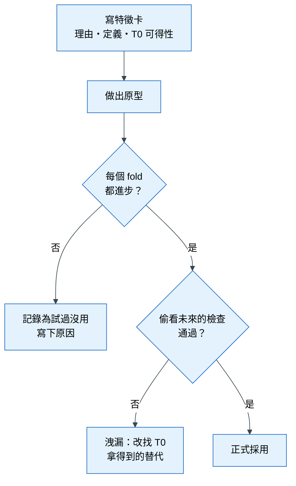

# 第 4 章 特徵工程（重點章）

> 本章心法：特徵 = 把**領域知識翻譯**成模型看得懂的訊號。好特徵講得出三件事：**來自哪個假設、預測當下拿得到、加進去之後真的有進步。**

## 學習目標

讀完本章，你應該能夠：

- 說明為什麼在表格資料上，特徵工程通常比換模型更有效
- 依「資料型態」與「模型種類」選擇合適的處理方式，並說出理由
- 用時點正確（point-in-time）的方式計算歷史統計特徵，避免偷看未來
- 用消融實驗與邊際價值判斷一個特徵值不值得留下

### 本章貫穿例子

一家家電零售商想在顧客**結帳的當下**，預測這筆訂單「30 天內會不會被退貨」。如果風險高，客服可以在出貨前先打電話確認規格，減少退貨的物流成本。

- 分析單位：一筆訂單
- 預測時點 T0：結帳當下（T0 的意思見[術語表](glossary.md)：切點左邊已知的資訊才能用）
- 目標：30 天內是否退貨

本章所有技巧都會套回這個例子。

---

## 4.1 為什麼特徵工程是表格資料最大的槓桿

### 遇到的麻煩

剛開始做模型的人，常常把時間花在換模型、調參數：今天試隨機森林，明天試梯度提升樹，後天調學習率。分數動了 0.002，卻說不清楚為什麼。

### 原理

模型只能從**你給它的欄位**裡找規律。如果資料表裡只有「商品編號」「價格」「結帳時間」，模型再厲害，也不會自己想到「這位顧客過去退過幾次貨」——因為這個資訊根本不在表裡，必須由人根據對業務的理解，把它**算出來**。

這就是特徵（feature）的意思：模型的一個輸入欄位。特徵工程（feature engineering）則是「把人腦中的業務知識，翻譯成模型可以使用的欄位」的過程。

實務經驗與研究都指出：在表格資料上，一個有業務意義的好特徵帶來的進步，往往大於換一個更複雜的模型。Kaggle 頂尖選手的經驗分享也一再強調，分組聚合（例如「每位顧客的平均消費」）是最有效的手段之一。

### 生活比喻

模型像一位很會算數的新進員工，但他不懂家電零售。你告訴他「退過貨的人比較容易再退貨」，他就能用得很好；你不告訴他，他永遠想不到。**特徵工程就是把老員工的經驗交給新員工。**

### 好特徵的三個條件

| 條件 | 白話 | 不滿足會怎樣 |
|---|---|---|
| 有來源假設 | 說得出「我為什麼覺得它有用」 | 只是盲目嘗試，增益很可能是巧合 |
| T0 拿得到 | 預測當下這個值已經存在 | 資料洩漏：驗證分數漂亮，上線崩盤 |
| 邊際有增益 | 加進既有特徵組合後，真的有穩健的進步 | 增加系統複雜度，卻沒有價值 |

所以實務上的順序是：**先寫下特徵的定義與理由（稱為特徵卡），再寫程式。** 寫不出理由的特徵，就不要做。

---

## 4.2 先看模型：同一個欄位，為什麼不同模型要不同處理

### 遇到的麻煩

網路上的教學常說「數值要標準化」「類別要 one-hot」。初學者照做之後，發現對某些模型有幫助，對另一些模型一點用都沒有，甚至變差。原因是：**前處理要配合模型「看資料的方式」。**

### 兩種模型看資料的方式

**樹模型**（決策樹、隨機森林、梯度提升樹如 LightGBM、XGBoost）的運作方式像一連串的是非題：「價格大於 15,000 嗎？」「是週末嗎？」。它只關心**大小順序**，不關心數字本身有多大。

- 例子：價格欄位不管是用「元」記錄（15,000）還是用「千元」記錄（15），問「大於 15,000 元嗎」和「大於 15 千元嗎」切出來的訂單完全相同。所以**縮放對樹模型沒有影響**。

**線性模型**（線性迴歸、邏輯迴歸）的運作方式是加權總和：「風險 = 0.3 × 價格 + 2.1 × 是否週末 + …」。它會直接拿數字去乘權重。

- 例子：價格以「元」記錄時數字很大（15,000），「是否週末」只有 0 或 1。如果模型有正則化（一種懲罰權重過大的機制，防止過度擬合），大數字和小數字被懲罰的程度不公平，模型就學歪了。所以**線性模型需要縮放**。
- 另一個限制：加權總和只能表達「越大越高」或「越大越低」的直線關係。如果退貨率在「中價位」最高、兩頭都低，線性模型抓不到，需要人幫它把價格**分箱**（切成低、中、高三段）。

### 整理

| 處理 | 樹模型 | 線性 / 邏輯迴歸 | 神經網路、KNN |
|---|---|---|---|
| 縮放、標準化 | 不需要（只看大小順序） | 需要（數字直接乘權重） | 需要 |
| 偏態轉換（取 log） | 不需要 | 有幫助 | 有幫助 |
| 缺失值 | 多數可以直接處理 | 必須補值，並加缺失旗標 | 必須補值 |
| 類別欄位 | 原生類別支援，或目標編碼、次數編碼 | one-hot | embedding 或 one-hot |
| 非線性、交互作用 | 自己會學 | 要人手動做（分箱、相乘） | 自己會學，但需要大量資料 |

**結論**：用樹模型時，把時間花在「有業務意義的新特徵」；用線性模型時，還要額外花時間在「調整數字的形狀」。

### 常見錯誤

- 對樹模型做了一堆標準化，以為會進步
- 對線性模型丟進沒處理過的長尾欄位（例如金額），讓少數極端值主導整個模型

---

## 4.3 數值型（連續）欄位

### 遇到的麻煩

數值欄位看起來可以直接丟進模型，但實際上常有四個問題：有缺失、分布極度偏斜、有極端值、單獨看沒什麼意義。

### 問題一：缺失值

訂單的「顧客年齡」有 20% 是空的。直接刪掉這些訂單會丟掉大量資料；隨便補 0 又會讓模型以為這些人都是 0 歲。

**做法**：補中位數，並**另外加一個「是否缺失」的欄位**。

**為什麼要加旗標**：缺失本身常常是訊號。例如不願意填年齡的顧客，可能是第一次購買、對平台還不信任，退貨率反而比較高。只補值不加旗標，這個訊號就被抹掉了。

### 問題二：偏態與長尾

訂單金額大多落在 1,000–5,000 元，但有少數訂單是 200,000 元的整套家電。對線性模型來說，這幾筆極大的值會主導權重。

**做法**：取對數 `log(1 + 金額)`。取對數之後，1,000 → 6.9、10,000 → 9.2、200,000 → 12.2，差距被壓縮，極端值不再主導。（樹模型不需要，因為它只看順序。）

### 問題三：極端值

**做法**：先確認是**錯誤**（例如金額多打了三個 0）還是**真實的極端**。錯誤就修正或移除；真實的極端值則截尾（winsorize）：把超過第 99 百分位的值，一律設成第 99 百分位的值，而不是刪掉這筆資料。

### 問題四：單獨看沒意義，組合起來才有意義

「運費 300 元」本身說明不了什麼；但「運費占訂單金額 30%」就很可疑——顧客可能是為了湊免運而亂買，退貨機率可能較高。

**做法**：建立**比率與差值**特徵。

| 原始欄位 | 衍生特徵 | 業務意義 |
|---|---|---|
| 運費、訂單金額 | 運費 ÷ 訂單金額 | 是否為了湊單 |
| 商品價格、同類商品平均價格 | 價格 ÷ 同類平均 | 是否買了特別貴的款式 |
| 預約安裝日、結帳時間 | 預約安裝日 − 結帳時間 | 等待越久，越可能改變心意 |

這類特徵**常常比原始欄位更有力**，因為它把「業務上真正在意的關係」直接交給模型。

### 整理

| 問題 | 做法 | 主要受益的模型 |
|---|---|---|
| 缺失 | 補中位數 + 缺失旗標 | 全部 |
| 偏態 | log、Box-Cox / Yeo-Johnson | 線性、神經網路 |
| 尺度不同 | 標準化 | 線性、神經網路、KNN |
| 極端值 | 先查原因，再截尾 | 線性 |
| 非線性 | 分箱、樣條 | 線性 |
| 單獨無意義 | 比率、差值 | 全部 |

---

## 4.4 類別型欄位

### 遇到的麻煩

模型只看得懂數字，但「品牌」「商品編號」「門市」是文字。要把文字變成數字，最直覺的方法是編號：Sony = 1、Panasonic = 2、LG = 3。

這個做法對線性模型是錯的：它會以為 LG（3）是 Sony（1）的三倍，或 Panasonic 介於兩者之間——但品牌之間根本沒有大小關係。

### 情況一：類別很少（低基數）

「付款方式」只有信用卡、貨到付款、轉帳三種。

**做法**：one-hot 編碼，也就是每一種類別各開一個 0/1 欄位：「是否信用卡」「是否貨到付款」「是否轉帳」。這樣就沒有假的大小關係。

### 情況二：類別非常多（高基數）

「商品編號」有 30,000 種。one-hot 會產生 30,000 個欄位，幾乎每個欄位都是 0，模型很難學。

高基數（high cardinality）的意思就是「一個類別欄位有非常多種不同的值」。

**做法 A：次數編碼**：把每個商品編號換成「這個商品在訓練資料裡出現幾次」。熱門商品和冷門商品的退貨行為往往不同。

**做法 B：目標編碼（target encoding）**：把每個商品編號換成「這個商品過去的退貨率」。這通常非常有力，但也**非常容易洩漏**，必須小心。

### 目標編碼為什麼會洩漏：一個 6 列的例子

假設訓練資料只有 6 筆訂單：

| 訂單 | 商品 | 是否退貨 |
|---|---|---|
| 1 | A | 1 |
| 2 | A | 0 |
| 3 | A | 1 |
| 4 | B | 0 |
| 5 | B | 0 |
| 6 | B | 1 |

**錯誤做法**：直接算每個商品的退貨率，A = 2/3、B = 1/3，填回每一列。

問題在於：訂單 1 的「A 的退貨率 2/3」裡面，**包含了訂單 1 自己的答案**。模型等於在考試時看到了自己的答案。資料少的類別特別嚴重：如果某商品只有 1 筆訂單，它的退貨率就是它自己的答案（0 或 1），模型可以完美背下來。

**正確做法：Out-of-fold（OOF）**：把訓練資料分成幾份（fold），每一列的編碼只用**其他份**的資料計算，不用到自己。

以 3 份為例：訂單 {1, 4} 一份、{2, 5} 一份、{3, 6} 一份。

| 訂單 | 商品 | 用哪些訂單計算 | 編碼值 |
|---|---|---|---|
| 1 | A | 訂單 2、3（其他 fold 的 A） | (0+1)/2 = 0.50 |
| 2 | A | 訂單 1、3 | (1+1)/2 = 1.00 |
| 3 | A | 訂單 1、2 | (1+0)/2 = 0.50 |
| 4 | B | 訂單 5、6 | (0+1)/2 = 0.50 |
| 5 | B | 訂單 4、6 | (0+1)/2 = 0.50 |
| 6 | B | 訂單 4、5 | (0+0)/2 = 0.00 |

每一列都沒有用到自己的答案。驗證集與上線時的新資料，則用**整份訓練資料**算出的對照表（A = 2/3、B = 1/3）。

### 再加上平滑：小樣本不可信

如果某個商品只賣過 2 次、退了 1 次，它的退貨率是 50%。但這很可能只是運氣——就像丟兩次硬幣出現一次正面，不代表這枚硬幣有問題。

**平滑（smoothing）**：把樣本少的類別，往整體平均拉。常見公式：

```
平滑後的值 = (該類別的退貨數 + m × 整體退貨率) ÷ (該類別的訂單數 + m)
```

`m` 代表「你願意相信整體平均的程度」，相當於先假設每個類別都有 m 筆「平均水準」的虛擬訂單。

例子：整體退貨率 10%，m = 10。

| 商品 | 訂單數 | 退貨數 | 原始退貨率 | 平滑後 |
|---|---|---|---|---|
| X（冷門） | 2 | 1 | 50% | (1 + 10×0.1) ÷ (2+10) = **16.7%** |
| Y（熱門） | 1,000 | 300 | 30% | (300 + 1) ÷ 1,010 = **29.8%** |

冷門商品被大幅拉回平均（50% → 16.7%），熱門商品幾乎不變（30% → 29.8%）。這正是我們要的：**資料越多，越相信它自己的數字。**

### 其他情況

- **有順序的類別**（小、中、大；一星到五星）：用 1、2、3 編號是對的，因為它們真的有大小順序
- **稀有類別**：出現次數很少的類別合併成「其他」
- **使用 CatBoost**：這個梯度提升樹模型內建了防洩漏的目標編碼（ordered target statistics），可以直接丟原始類別

### 整理

| 情況 | 做法 | 注意 |
|---|---|---|
| 低基數（十幾種以內） | one-hot | 樹模型也可用原生類別支援 |
| 高基數 | 次數編碼、目標編碼（OOF + 平滑） | 目標編碼不做 OOF 就是洩漏 |
| 有順序 | 依序編號 | 不要用 one-hot 丟掉順序 |
| 稀有類別 | 合併成「其他」 | 門檻依樣本數決定 |

### 常見錯誤

- 在全部資料上算目標編碼，再切分訓練與驗證 → 驗證集的答案混進了特徵
- 新出現、訓練時沒見過的類別填 0 → 模型以為它的退貨率是 0；應該填整體平均

---

## 4.5 日期時間欄位

### 遇到的麻煩

「結帳時間 = 2024-11-29 23:41」這個值，模型直接看是一串數字，看不出任何意義。但人一看就知道：這是**黑色星期五的深夜**——衝動購物、之後後悔退貨的機率可能較高。

### 做法一：拆出分量

把時間拆成模型看得懂的部分：小時、星期幾、月份、是否假日、是否月底（發薪日附近）。

### 做法二：週期編碼（給線性模型與神經網路）

「小時」拆出來是 0–23。對線性模型來說，23 點和 0 點差了 23，是最遠的兩個值；但實際上它們只差一小時。

**做法**：把小時轉成一個圓上的座標：`sin(2π × 小時 / 24)` 和 `cos(2π × 小時 / 24)`。就像時鐘的指針，23 點和 0 點在圓上是相鄰的。樹模型不需要這樣做。

### 做法三：時間差（通常最有力）

兩個 **T0 已知**的時間點相減，常常比時間點本身更有意義：

| 時間差 | 業務意義 |
|---|---|
| 預約安裝日 − 結帳時間 | 要等越久，越可能反悔 |
| 結帳時間 − 這位顧客上次購買時間 | 很久沒買的人突然下單，可能是特殊需求 |
| 結帳時間 − 最近的大促銷日 | 促銷前後的衝動購物 |

### 危險：絕對時間趨勢

「年份」「這是平台上第幾筆訂單」「顧客累計下單次數」這類欄位會隨時間**一直變大**。

**問題在哪**：假設訓練資料是 2022–2023 年，上線時是 2024 年。上線時「年份 = 2024」，是模型從來沒見過的值；累計次數也全部超出訓練時的範圍。樹模型遇到沒見過的範圍，只能套用訓練時最邊緣的規則，結果不可預期。這就是**分布漂移**（訓練時和上線時的資料長得不一樣）。

**做法**：用比率取代累計數。例如「累計退貨次數」→「退貨次數 ÷ 購買次數」，或改用「近 90 天」的視窗。比率不會無限變大，比較穩定。

---

## 4.6 歷史與序列特徵

這是表格資料中**最有力、也最容易出錯**的一類特徵。

### 遇到的麻煩

直覺告訴我們：「過去常退貨的顧客，未來也比較會退貨。」所以想做一個特徵：「這位顧客的退貨率」。

**錯誤做法**：用整份資料，算出每位顧客的退貨率，再填回每一筆訂單。

### 為什麼錯：一條時間線

顧客小陳有 4 筆訂單：

```
時間 →   1月        3月        6月        9月
訂單     ①買電視    ②買冰箱    ③買洗衣機   ④買冷氣
退貨     否         是          是          否
```

用整份資料算，小陳的退貨率 = 2/4 = 50%，這個值被填到每一筆訂單上。

現在看訂單 ②（3 月）。在 3 月結帳的那一刻，我們**只知道** 1 月的訂單沒退貨。但填進去的 50% 用到了 ②、③ 自己的退貨結果——③ 在 6 月才發生，那是**未來**。模型等於在 3 月就知道小陳 6 月會退貨。

### 正確做法：時點正確（point-in-time）

計算任何歷史統計時，只用 **T0 之前已經被觀察到**的事件，並且**排除自己**。

| 訂單 | T0 | T0 之前已知的歷史 | 時點正確的退貨率 |
|---|---|---|---|
| ① | 1 月 | 無 | 沒有歷史（見下方「新顧客」） |
| ② | 3 月 | ①：否 | 0/1 = 0% |
| ③ | 6 月 | ①否、②是 | 1/2 = 50% |
| ④ | 9 月 | ①否、②是、③是 | 2/3 = 67% |

注意「**被觀察到**」這幾個字：訂單 ③ 是 6 月買的，但「是否退貨」要等 30 天後才知道。如果 ④ 的 T0 是 6 月 20 日，那時 ③ 的退貨結果還沒出來，就不能算進去。**判斷標準是「結果何時被知道」，不是「事件何時發生」。**

在 pandas 裡，`merge_asof(..., allow_exact_matches=False)` 是實作時點正確聚合的標準工具：它幫每一筆目標資料，找出時間嚴格早於它的最新歷史紀錄。

### 新顧客怎麼辦

訂單 ① 沒有任何歷史。如果填 0%，模型會以為「新顧客退貨率是 0」，把「新」誤認為「表現很好」。

**做法**：填**整體平均**（例如 10%），或使用 4.4 節的平滑公式，讓沒有歷史的顧客從整體平均出發，隨著訂單變多再慢慢相信他自己的紀錄。另外可以加一個「歷史訂單數」欄位，讓模型知道這個退貨率有多可信。

### 序列資料的常見特徵

當資料是「同一個對象隨時間不斷累積的紀錄」（例如每天的銷量、每月的消費），常用以下幾種特徵：

| 類型 | 白話 | 例子 | 防洩漏要點 |
|---|---|---|---|
| 落後值（lag） | 往前看第 k 期的值 | 上週同一天的銷量 | k 必須大於等於預測距離：要預測 7 天後，就不能用昨天的值 |
| 滾動統計（rolling） | 過去一段時間的平均、次數、最大值 | 過去 30 天的平均消費 | 視窗只包含 T0 之前，不含當天 |
| 累計統計（expanding） | 從頭到現在的累計 | 到目前為止的退貨率 | 用比率，不用次數（避免漂移） |
| 變化量 | 近期和長期的比較 | 近 30 天消費 ÷ 近 365 天月平均 | 抓「最近變了」 |

---

## 4.7 多表、文字與地理

### 多表關聯：一對多的陷阱

**遇到的麻煩**：訂單表一列是一筆訂單；明細表一列是一個商品。一筆訂單買了 3 個商品，明細表就有 3 列。

如果直接把兩張表合併（join），這筆訂單會變成 3 列，**訂單金額被重複計算 3 次**，資料筆數也跟著膨脹。模型看到的「訂單」數量是錯的，各種統計也全部失真。

**做法**：先把明細表**聚合到訂單層級**，再合併。

| 聚合方式 | 例子 |
|---|---|
| 次數 | 這筆訂單有幾個商品 |
| 加總、平均、最大值 | 總重量、平均單價、最貴的商品價格 |
| 不重複數 | 買了幾種不同的品類 |
| 主要項目 | 最貴的那個商品的品類 |

### 文字

先做便宜的：字數、是否包含某些關鍵字（例如備註欄有「送禮」）。有需要再做 TF-IDF（依詞的稀有程度加權的字詞統計）或 embedding（用預訓練模型把一段文字轉成一串數字）。

**一定要先確認文字在 T0 存在**：顧客的「退貨原因說明」在結帳當下根本不存在，絕對不能用。

### 地理

- 兩點距離：倉庫到顧客的距離（用經緯度計算的球面距離）
- 是否同區域：是否同縣市
- 區域統計：這個區域過去的退貨率（同樣要時點正確）
- 郵遞區號：當作高基數類別處理

---

## 4.8 怎麼判斷一個特徵有沒有用

### 遇到的麻煩

做了一個新特徵，加進模型後分數從 0.300 變成 0.304。這是進步嗎？也可能只是運氣。又或者，一次加了 20 個特徵，分數進步了，但不知道是哪一個的功勞。

### 原則一：一次只加一組（消融實驗）

**消融實驗（ablation）**：一次只加入或拿掉一組特徵，其他條件（資料切分、模型、參數）全部固定，看分數變化。就像做菜時一次只改一種調味料，才知道味道變好是因為哪一樣。

### 原則二：看邊際價值，不看單獨表現

**邊際價值**：在**已經有其他特徵**的情況下，再加入這個特徵能多帶來多少進步。

一個特徵單獨拿來預測可能很準，但如果它的資訊和已有的特徵高度重疊，加進去就沒有幫助。例如已經有「顧客過去的退貨率」，再加「顧客過去的退款金額」，兩者講的幾乎是同一件事。

### 原則三：每個 fold 都進步才算數

用交叉驗證的每一次考試（fold）分別比較，而不是只看平均（見第 3 章的同 fold 配對比較）。只有每一次都進步，才算穩健。

### 原則四：重要度要在驗證集上看

很多模型會提供「特徵重要度」，但那是在**訓練集**上算的，模型背下來的雜訊也會顯得很重要。

**置換重要度（permutation importance）**：在**驗證集**上，把某一個特徵的值隨機打亂，看分數掉多少。掉越多，代表模型越依賴它；幾乎不掉，代表它可有可無。

### 一個特徵的評估流程

下面這張圖回答一個問題：「一個新特徵從想法到被正式採用，要經過哪些關卡？」每一個關卡都在擋一種錯誤：沒有理由的嘗試、雜訊增益、資料洩漏。



**怎麼讀這張圖**：從最上面的「寫特徵卡」開始往下走。兩個菱形是兩道關卡：第一道擋掉「只是運氣」的增益，第二道擋掉「偷看未來」的增益（檢查方法見第 3 章的擾動測試）。要記住的是：**沒通過的特徵也要記錄原因**，否則下一次會有人再試一次同樣的東西。

### 常見錯誤

- 一次加 100 個特徵再看哪個有用 → 雜訊和洩漏全部混在一起，分不出來
- 在全部資料上先做特徵篩選，再做交叉驗證 → 篩選時已經看過驗證資料的答案，也是洩漏
- 只看訓練集的內建重要度就刪特徵

---

## 本章小結

1. 在表格資料上，好特徵通常比換模型更有效；特徵工程是把業務知識翻譯成欄位。
2. 前處理要配合模型：樹模型只看順序，不需要縮放；線性模型直接乘權重，需要縮放與形狀轉換。
3. 高基數類別用目標編碼時，必須做 out-of-fold 與平滑，否則就是洩漏或過度相信小樣本。
4. 歷史特徵要時點正確：只用 T0 前「已被觀察到」的事件、排除自己；新對象給整體平均，不給 0。
5. 判斷特徵價值：一次只加一組、看邊際價值、每個 fold 都進步、在驗證集上看置換重要度。

## 習題

1. （概念）為什麼標準化對 LightGBM 沒有影響，對邏輯迴歸卻有影響？請用「是非題」與「加權總和」的觀點說明。
2. （概念）目標編碼為什麼要做 out-of-fold？如果某個類別只有一筆資料，不做 OOF 會發生什麼事？
3. （應用）一個有 3,000 種值的「門市代號」欄位，給 LightGBM 和給邏輯迴歸各要怎麼處理？
4. （應用）設計「顧客過去 90 天的退貨率」特徵：寫出時點正確的計算規則，並說明新顧客怎麼處理。
5. （思辨）一個特徵單獨預測的效果很好，加進模型後卻沒有進步。列出至少兩種可能的原因，並說明你會怎麼確認。

## 圖文建議

| 圖 | 呈現什麼 | 形式 |
|---|---|---|
| ★ 資料型態 × 處理方式地圖 | 數值、類別、時間、歷史、多表、文字、地理各自的主要做法 | 矩陣圖 |
| 樹 vs 線性怎麼看資料 | 左邊一棵是非題樹、右邊一條加權總和公式，同一個價格欄位 | 並排示意圖 |
| 目標編碼 OOF | 4.4 節的 6 列表格，用顏色標出每一列用了哪些列 | 方格示意圖 |
| 時點正確的時間線 | 4.6 節小陳的 4 筆訂單，正確 vs 偷看未來並排 | 時間線 |
| 平滑的效果 | 冷門與熱門商品，平滑前後的值 | 前後對照長條圖 |
| 一對多 join 膨脹 | 1 筆訂單 × 3 個商品 → 金額重複 3 次；先聚合再合併 | 錯誤 vs 正確並排 |

## 延伸閱讀

- Kuhn & Johnson, *Feature Engineering and Selection*；NVIDIA, *Kaggle Grandmasters Playbook*；*Target Encoding Without Leakage*（見[參考文獻](references.md)）
- 本章術語的白話解釋見[術語表](glossary.md)
