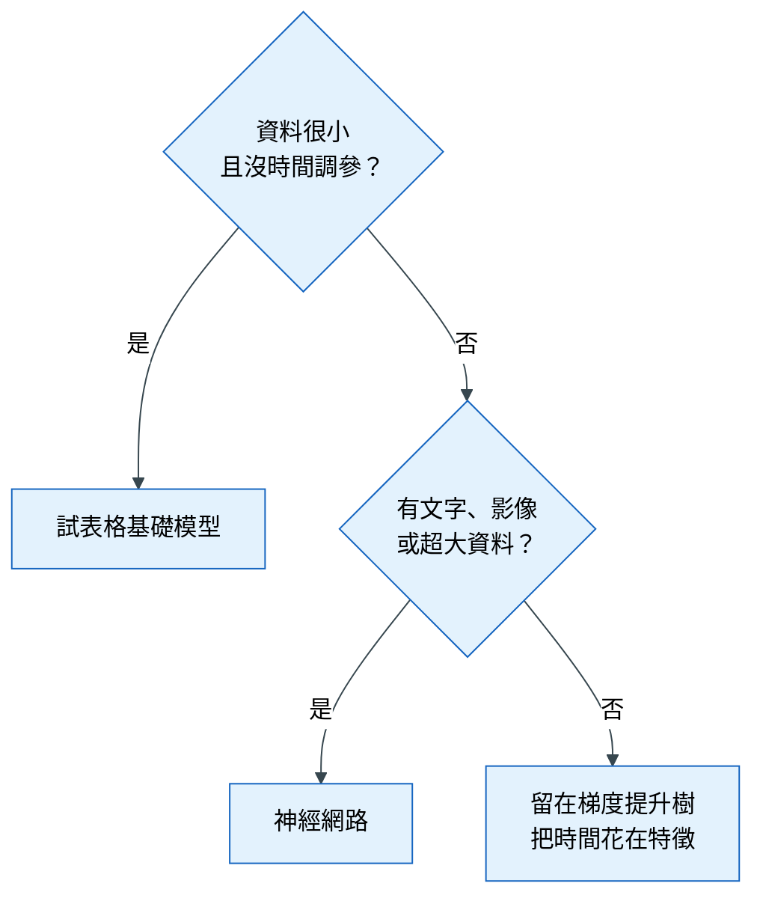

# 第 5 章 模型選擇與評估

> 本章心法：模型是畫龍點睛：**先有基準，再談升級。** 在表格資料上，換模型帶來的進步，通常小於一個好特徵。

## 學習目標

讀完本章，你應該能夠：

- 說明為什麼一定要從基準模型開始，並建立兩種基準
- 用直覺說明線性模型、決策樹、隨機森林、梯度提升樹、表格基礎模型各自怎麼運作
- 依資料規模、特徵型態、解釋需求與部署限制選擇模型
- 設計公平的模型比較，並用過擬合差距與校準檢查模型是否可用

### 本章貫穿例子

一家銀行在審核信用卡申請時，想預測「申請人在 12 個月內會不會違約」。

- 分析單位：一筆申請
- 預測時點 T0：審核當下
- 資料：約 8,000 筆歷史申請、30 個欄位（收入、年資、既有負債、過去繳款紀錄等）
- 限制：主管機關要求**每一筆拒絕都要能說明理由**

---

## 5.1 為什麼一定要從基準開始

### 遇到的麻煩

一位分析師興奮地報告：「我用梯度提升樹做出來的模型，PR-AUC 是 0.32！」（PR-AUC 是衡量「能不能把真正違約的人排在前面」的指標，越大越好，見[術語表](glossary.md)。）

主管問：「0.32 是好還是不好？」他答不出來。

### 原理

一個分數本身沒有意義，只有和「什麼都不做」比較才有意義。

如果整體違約率是 15%，一個完全不學習、給每個人同樣機率的方法，PR-AUC 大約就等於 15%（0.15）。所以 0.32 代表「比亂猜好一倍多」——這才是主管聽得懂的話。

這個「完全不用動腦的預測方法」就叫**基準模型（baseline）**。

### 兩種基準，回答兩個不同的問題

| 基準 | 是什麼 | 回答的問題 |
|---|---|---|
| 不學習的基準 | 分類：永遠猜整體違約率；數量：永遠猜平均；時間序列：上週同一天的值 | 「這個模型值不值得做？」 |
| 簡單模型基準 | 邏輯迴歸，只用原始欄位，不做任何特徵工程 | 「特徵工程和複雜模型值不值得做？」 |

### 模型階梯

於是模型的選擇變成一道階梯：**不學習的基準 → 簡單模型 → 複雜模型**。每往上一階，都必須穩健地贏過下一階，才值得承擔它帶來的複雜度。

### 常見錯誤

- 一開始就上最複雜的模型，沒有任何比較對象
- 只報告分數，不報告基準的分數

---

## 5.2 常用模型怎麼運作

選模型之前，要先知道每種模型「用什麼方式思考」。以下用直覺說明，不涉及數學推導。

### 線性模型與邏輯迴歸：加權總和

**怎麼運作**：把每個欄位乘上一個權重再加起來：

```
違約分數 = 0.8 × 負債收入比 − 0.5 × 年資 + 1.2 × 過去是否遲繳 + …
```

邏輯迴歸再把這個分數轉換成 0 到 1 之間的機率。

**比喻**：像一張評分表，每一項各占幾分，加總起來決定結果。

**優點**：每個權重都看得懂（「過去遲繳的人，風險較高」），所以**容易解釋**；資料少時也穩定，不容易背答案。
**缺點**：只能表達「越大越高」或「越大越低」的直線關係。如果風險在中等收入最高、兩頭都低，它抓不到，需要人幫忙做特徵（見第 4 章）。

### 決策樹：一連串的是非題

**怎麼運作**：「負債收入比大於 0.4 嗎？」→ 是 →「過去一年有遲繳嗎？」→ 是 → 高風險。

**比喻**：像醫生問診的流程圖。

**優點**：規則直觀，能自然處理非線性關係。
**缺點**：一棵樹很不穩定：資料稍微變一點，問的問題就可能完全不同；而且容易一路問到很細，把訓練資料背下來。所以實務上很少單獨使用。

### 隨機森林：很多棵樹投票

**怎麼運作**：訓練幾百棵樹，每棵樹只看到一部分資料和一部分欄位，最後讓所有樹投票。

**比喻**：與其相信一位專家，不如問 500 位各有偏好的專家，取多數意見。個別專家的怪癖會互相抵消。

**優點**：比單棵樹穩定得多，幾乎不用調參數，是很好的快速基準。
**缺點**：模型檔案大；每棵樹都長得很深，仍然容易記住訓練資料。

### 梯度提升樹：很多棵小樹接力修正錯誤

**怎麼運作**：先訓練一棵很小的樹，看它哪裡猜錯；再訓練第二棵小樹，專門修正第一棵的錯誤；第三棵再修正前兩棵剩下的錯誤……一直接力下去。常見的實作有 LightGBM、XGBoost、CatBoost。

**比喻**：像寫作文時不斷修改：第一稿抓大意，第二稿修錯字，第三稿調語氣，每一次只改「上一版還不好的地方」。

**優點**：在表格資料上通常表現最好，速度快，能直接處理缺失值。
**缺點**：參數較多，調得太激進一樣會過度擬合。

### 表格基礎模型（如 TabPFN）：看過大量小資料集的預訓練模型

**怎麼運作**：研究者先用數以百萬計的「模擬小資料集」訓練一個大模型，讓它學會「看到一份新的小表格時，該怎麼預測」。使用時不需要重新訓練或調參數，把你的資料交給它就能預測。

**比喻**：像一位做過上百萬題練習題的考生，看到新題目時能很快抓到規律。

**優點**：在數千到數萬列的小資料上，幾乎不用調參就有很強的表現（Hollmann et al., 2025，Nature）。
**缺點**：能處理的資料規模有上限；預測時需要較多運算資源；較新版本的成績多來自開發者自己的評測，採用前要用自己的資料驗證。

### 神經網路

**怎麼運作**：很多層的加權總和疊在一起，中間加入非線性的轉換，能學習非常複雜的關係。

**優點**：處理文字、影像、聲音、超大型資料時最強。
**缺點**：在一般表格資料上，通常輸給梯度提升樹，而且需要大量調參。

### 為什麼表格資料上樹模型通常贏過神經網路

Grinsztajn 等人（2022）的研究比較了大量中型表格資料集，發現樹模型仍然領先，原因主要有兩個：

1. **表格資料的規律常常是「不規則」的**：例如收入在某個門檻以上風險突然下降。樹模型用是非題切一刀就能表達；神經網路傾向學出平滑的曲線，反而不擅長。
2. **表格資料常有很多沒用的欄位**：樹模型會自然忽略用不到的欄位；神經網路會把所有欄位混在一起計算，容易被雜訊干擾。

### 整理

| 模型 | 運作直覺 | 強項 | 弱項 | 適合 |
|---|---|---|---|---|
| 線性 / 邏輯迴歸 | 加權總和 | 可解釋、穩定 | 只能表達直線關係 | 基準、需要解釋、資料少 |
| 決策樹 | 一連串是非題 | 規則直觀 | 不穩定、易背答案 | 教學與解釋示範 |
| 隨機森林 | 很多樹投票 | 穩健、少調參 | 模型大 | 快速基準 |
| **梯度提升樹** | 小樹接力修正 | 表格資料的預設強者 | 參數多 | **大多數表格任務** |
| CatBoost | 同上，內建類別處理 | 類別欄位多時表現好 | 訓練較慢 | 高基數類別多 |
| 表格基礎模型 | 預訓練、看過大量小資料集 | 小資料免調參 | 規模上限、運算成本 | 數千到數萬列 |
| 神經網路 | 多層加權總和 | 文字、影像、超大資料 | 表格上常輸給樹 | 非表格或多模態 |

---

## 5.3 怎麼選：從問題條件出發

### 遇到的麻煩

知道每個模型的特性之後，還是不知道該選哪個。答案是：**讓問題的條件幫你選。**

### 選擇順序

第一張圖回答：「不管什麼問題，前三步都一樣嗎？」答案是一樣。不論資料長什麼樣，都先建立基準、再試簡單模型、再試梯度提升樹，因為後面每一步的價值，都要靠前一步來衡量。


**怎麼讀這張圖**：從左往右，每一步都要和前一步比較。② 贏不了 ①，代表資料裡可能沒有可學的訊號，要回頭檢查問題定義；③ 贏不了 ②，代表關係大致是直線的，留在簡單模型就好。

第二張圖回答：「做完第三步之後，什麼情況下要換別的模型？」



**怎麼讀這張圖**：從上面的菱形開始回答問題。大多數的表格問題會走到最右下角：「留在梯度提升樹，把時間花在特徵」。這張圖要記住的是：**換模型是例外，不是常態。**

### 選模型時問的五個問題

| 問題 | 怎麼影響選擇 | 本章例子 |
|---|---|---|
| 資料有多少列、多少欄？ | 小 → 線性、表格基礎模型；中大 → 梯度提升樹 | 8,000 列、30 欄，屬於小資料 |
| 欄位是什麼型態？ | 高基數類別多 → CatBoost；有文字、影像 → 加 embedding | 多為數值 |
| 需要解釋到什麼程度？ | 法規或決策者要理由 → 線性，或樹模型搭配 SHAP（一種說明每個欄位對單筆預測貢獻多少的方法） | **法規要求說明拒絕理由** |
| 部署有什麼限制？ | 預測速度、運算資源、模型大小 | 批次審核，速度不是問題 |
| 要的是排序還是機率？ | 要機率 → 必須檢查校準（見 5.4） | 要用機率訂額度，需要校準 |

**例子的結論**：銀行常選擇「邏輯迴歸 + 分箱」的評分卡，即使梯度提升樹的分數略高。因為法規要求解釋每一筆拒絕，而邏輯迴歸的每個權重都能直接說明。這說明了**最好的模型不一定是分數最高的模型，而是最符合決策需求的模型。**

---

## 5.4 公平比較與可用性檢查

### 遇到的麻煩

分析師說：「梯度提升樹 0.32，比邏輯迴歸的 0.29 好。」但仔細一看：梯度提升樹用了 50 個特徵、調了一整天參數；邏輯迴歸只用了 10 個原始欄位、沒有調參。這個比較說明不了「哪個模型比較好」，因為**同時改了太多東西**。

### 公平比較的三個條件

1. **相同的資料切分**：兩個模型在同樣的幾次考試（fold）上比較
2. **相同的特徵**：要比模型，就只換模型；特徵固定
3. **對等的調參預算**：不能一個調一整天、一個用預設值

比較時用第 3 章介紹的**同 fold 配對比較**：看新模型是不是在**每一次**考試都贏，而不只是平均比較高。

### 過擬合差距：模型是在學規律，還是在背答案

**過擬合（overfitting）**：模型把訓練資料的雜訊也背了下來，在訓練資料上表現很好，遇到新資料就變差。就像學生把考古題的答案背熟，題目稍微換一下就不會了。

**過擬合差距（overfit gap）** = 訓練分數 − 驗證分數。

| 情況 | 訓練 | 驗證 | 差距 | 解讀 |
|---|---|---|---|---|
| 健康 | 0.35 | 0.32 | 0.03 | 學到的規律能推廣到新資料 |
| 背答案 | 0.80 | 0.30 | 0.50 | 大量記憶訓練資料，推廣能力差 |

如果換了一個模型，驗證分數只高了一點、差距卻大了很多，這個進步通常不穩定：換一批新資料，很可能就消失了。

### 校準：模型說「30%」時，真的是 30% 嗎

**遇到的麻煩**：銀行要用模型輸出的機率來決定額度：違約機率 5% 給高額度，30% 給低額度。但有些模型的「排序」很準（高風險的人確實排在前面），輸出的「機率數字」卻不準：它說 30% 的那群人，實際違約率可能是 50%。

**校準（calibration）**：檢查「模型說的機率」和「實際發生的比例」是否一致。

**怎麼檢查**：把所有申請依模型給的機率分成 10 組，看每一組「平均預測機率」和「實際違約率」是否接近。完美校準時，兩者會落在一條對角線上。

**怎麼修正**：用 Platt scaling 或 isotonic regression 對模型輸出做一次轉換，讓數字貼近實際比例。

**什麼時候需要**：只要你會「直接使用機率的數值」（訂價、額度、預期損失），就需要校準；如果只是「排序取前幾名」，排序正確就夠了。

### 其他原則

- **調參數只用交叉驗證，絕不碰保留集（holdout）**：保留集只能在最後看一次（見第 3 章）
- **集成（ensemble，把多個模型的預測合併）放最後**：它通常只帶來小幅進步，卻增加維護成本；先把單一模型和特徵做好

### 常見錯誤

- 不同模型用不同的特徵或切分來比較
- 花一週調參，換來的進步比一個好特徵還小
- 需要機率卻沒有檢查校準
- 只看驗證分數，不看過擬合差距

---

## 本章小結

1. 先建立兩種基準：不學習的基準（值不值得做模型）與簡單模型基準（值不值得做複雜的事）。
2. 線性模型是加權總和、決策樹是是非題、隨機森林是投票、梯度提升樹是接力修正、表格基礎模型是預訓練的通才。
3. 表格資料的預設選擇是梯度提升樹；但最符合決策需求（例如可解釋性）的模型，才是最好的模型。
4. 公平比較：相同切分、相同特徵、對等調參，並用同 fold 配對比較。
5. 除了驗證分數，還要看過擬合差距；需要使用機率數值時，要檢查校準。

## 習題

1. （概念）為什麼模型比較要在「同一組特徵」上進行？如果特徵不同，你能從結果得到什麼結論？
2. （概念）用你自己的話，說明隨機森林與梯度提升樹的差別（提示：投票 vs 接力）。
3. （應用）一份 3,000 列、20 個欄位的資料，主管需要知道「為什麼」，你會先試哪兩個模型？理由是什麼？
4. （應用）梯度提升樹平均比邏輯迴歸高 0.01，但在 3 次考試中只贏了 2 次，訓練與驗證的差距還變大了。你會怎麼下結論？
5. （思辨）花一週調參換到 +0.005，與花一天做一個新特徵換到 +0.02，哪個比較值得？在什麼情況下答案會反過來？

## 圖文建議

| 圖 | 呈現什麼 | 形式 |
|---|---|---|
| ★ 模型的思考方式 | 加權總和、是非題、投票、接力修正、預訓練通才，各一個小插圖 | 五格插畫 |
| 模型階梯 | 5.3 節的兩張圖 | 流程圖 |
| 增益來源瀑布圖 | 基準 → 特徵工程 → 換模型 → 調參，各自帶來多少進步 | 瀑布圖 |
| 過擬合差距 | 模型越複雜，訓練分數一路上升、驗證分數先升後降 | 雙折線圖 |
| 校準曲線 | 預測機率 vs 實際比例，完美校準是一條對角線 | 散佈圖加對角線 |

## 延伸閱讀

- Grinsztajn et al. (2022)；Hollmann et al. (2025)；TabPFN-2.5（見[參考文獻](references.md)）
- 本章術語的白話解釋見[術語表](glossary.md)
