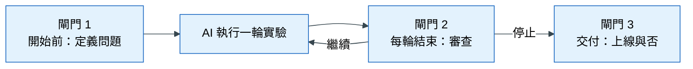

# 第 6 章 人機協作的資料科學

> 本章心法：AI 讓實驗變便宜，所以**判斷哪個結果可信**，成為人類最有價值的能力。

## 學習目標

讀完本章，你應該能夠：

- 說明 AI 如何改變資料科學工作的成本結構，以及人的時間該移到哪裡
- 辨識「合理但錯誤」的失敗模式，並說出為什麼它特別危險
- 劃分人類與 AI 的責任，指出必須由人決定的時點與理由
- 用驗收思維審查 AI 產出的分析結論

### 本章貫穿例子

一家連鎖超市的分析師小林，請 AI 助手幫忙預測「哪些會員下個月會流失」。AI 在一個下午內跑了 40 個實驗，最後回報：「最佳模型的 PR-AUC 從 0.21 提升到 0.38，主要貢獻來自新特徵『會員最後一次來店距今天數』。」

小林該怎麼判斷這個結果能不能相信？本章圍繞這個情境展開。

---

## 6.1 成本結構的轉移

### 遇到的麻煩

過去，一位分析師一天可能只跑得完兩、三個實驗：寫程式、除錯、畫圖都要時間。現在 AI 助手一個下午就能跑 40 個。看起來產能提升了十幾倍，但小林很快發現一個新問題：**他沒有時間一一檢查這 40 個結果是不是對的。**

### 原理

AI 讓「做出來」的成本大幅下降：寫分析程式、畫圖、跑實驗，邊際成本都趨近於零。但有些事情的成本沒有變：

- **定義問題**：要預測什麼、給誰用、什麼時候用，需要懂業務
- **判斷證據**：這個進步是真的、是巧合，還是洩漏
- **承擔決策**：要不要上線、出錯了誰負責

當結果的數量暴增，而判斷的速度沒有變，**瓶頸就從「做得出來」移到了「判斷得出來」**。這就是成本結構的轉移。

| 工作 | 過去的成本 | AI 時代的成本 |
|---|---|---|
| 寫分析程式 | 高 | 低 |
| 跑大量實驗 | 高 | 低 |
| 定義問題與成功標準 | 高 | **仍然高** |
| 判斷結果是否可信 | 中 | **更高**（要判斷的結果變多了） |
| 承擔決策後果 | 高 | **仍然高** |

### 推論

人的時間應該從「執行」轉向三件事：**定義**（事先說清楚要什麼）、**驗收**（檢查結果對不對）、**裁決**（決定留什麼、下一步做什麼）。

### 常見錯誤

- 把 AI 的產能當成自己的產能，結果被大量未經檢查的結論淹沒
- 以為 AI 跑得多，就代表分析做得好

---

## 6.2 「合理但錯誤」的失敗模式

### 遇到的麻煩

回到小林的例子。AI 的報告看起來無懈可擊：程式能執行、分數大幅進步、說明文字通順，還附了漂亮的圖。但「會員最後一次來店距今天數」這個特徵，是用**哪一天**當「今天」計算的？

如果「今天」用的是資料集的最後一天，而不是每一筆預測的當下，那麼對三個月前的預測來說，這個特徵已經包含了「這位會員之後三個月都沒來」的資訊——這正是「流失」的定義。模型等於拿答案來猜答案。

### 原理

這類錯誤有一個共同特徵：**程式不會報錯，結果看起來很合理，但結論建立在錯誤的前提上。** 我們稱之為「合理但錯誤」。

它比程式錯誤危險得多：

- 程式錯誤會讓程式停下來，你一定會發現
- 合理但錯誤的結果會一路通過，直到上線後才崩盤

而 AI 特別容易產生這類錯誤，因為它擅長產出「看起來正確」的程式與敘述，卻不一定理解業務流程中「這個資訊什麼時候才會知道」。

### 五種常見型態

| 型態 | 白話 | 例子 |
|---|---|---|
| 使用未來資訊 | 特徵用到預測當下還不知道的事 | 用資料集最後一天計算「距今天數」 |
| 只看平均 | 平均分數進步，但只在某一次考試有效 | 三個月中只有一個月進步很多 |
| 相關當因果 | 把預測力強的變數，當成可以介入的原因 | 「常用優惠券的人比較不流失」→ 發更多優惠券就能留住人？ |
| 錯誤的驗證設計 | 驗證方式沒有模擬上線情境 | 預測未來卻用隨機切分 |
| 自我說服 | 用同一份資料發現模式，又用它來證明模式 | 在全部資料上挑出最好的特徵，再用同一份資料驗證 |

### 怎麼發現

這些錯誤沒辦法靠「程式有沒有報錯」發現，只能靠兩件事：**正確的驗證設計**（第 3 章）與**對業務流程的理解**（第 1 章）。這兩件事正是人類的責任。

---

## 6.3 規範制度化

### 遇到的麻煩

小林發現問題後，在交代 AI 的工作說明裡加了一句：「計算特徵時，不能用到預測當下之後的資訊。」下一次，AI 遵守了。再下一次，換了一個新對話，AI 又忘了。

### 原理

口頭或臨時的提醒，依賴「記得」與「自律」，而這兩件事對人和 AI 都不可靠。可靠的做法是**把規範變成會自動執行的機制**，讓規則不需要被記住也會生效。這叫做規範制度化。

就像工廠不會只靠「請小心操作」的標語，而是在機器上裝安全護欄：不小心也不會受傷。

### 多層防線

沒有任何單一機制能擋住所有錯誤，所以要疊好幾層，每一層擋不同的東西。

下面這張圖回答：「一個錯誤要穿過哪些關卡，才會跑到決策者面前？」越往右的關卡越昂貴、也越聰明。

**怎麼讀這張圖**：從左往右，每一層都擋下一部分錯誤，漏網的才進到下一層。要記住的是：**最後一層必須是人**，因為只有人能判斷「這個目標在業務上合不合理」。

| 層 | 形式 | 擋得住 | 擋不住 |
|---|---|---|---|
| 書面規範 | 寫成文件的工作守則，每次開工都要讀 | 預設的錯誤行為 | 遺忘或誤解 |
| 權限控制 | 禁止讀取答案資料、禁止修改原始資料 | 越界的操作 | 邏輯上的錯誤 |
| 自動測試 | 洩漏測試（例如第 3 章的擾動測試）、邊界測試 | 已知類型的錯誤 | 驗證設計本身的錯誤 |
| 獨立審查 | 另一個人或另一個 AI，用懷疑的立場重新檢查 | 不穩健的增益、可疑的大幅進步 | 業務目標本身錯了 |
| 人類裁決 | 定期的審查與決策 | 以上所有的漏網之魚 | — |

### 常見錯誤

- 只靠口頭提醒，期待每次都被記住
- 有了自動測試，就以為不需要人看了

---

## 6.4 人類決策點

### 遇到的麻煩

既然 AI 這麼能幹，能不能讓它從頭做到尾，人只看最後的報告？

### 原理

不行，因為有些決定需要**業務情境**與**承擔後果的責任**，這兩件事 AI 都沒有。如果把這些決定交給 AI，人類最後只是在一份看不懂來龍去脈的報告上蓋章。

所以要在流程中設定幾個**閘門**：AI 做到這裡必須停下來，由人決定才能繼續。

下面這張圖回答：「一個專案裡，哪三個時刻必須由人拍板？」

**怎麼讀這張圖**：三個「閘門」方塊是人做決定的地方，中間的「AI 執行」可以重複很多輪。注意閘門 2 的回頭箭頭：**是否繼續下一輪，是人決定的，不是 AI。**

| 時點 | 人類決定什麼 | 為什麼不能交給 AI |
|---|---|---|
| 開始前 | 要支援什麼決策、預測時點、可用資訊、驗證方式、停止條件 | 需要理解業務情境；定錯了，後面全部白做 |
| 每輪結束 | 哪些結論值得留下、下一步做什麼、要不要停止 | 涉及成本、風險與優先順序的取捨 |
| 交付時 | 要不要上線、怎麼向決策者說明限制 | 需要有人承擔後果 |

---

## 6.5 記錄即記憶

### 遇到的麻煩

第二週，小林開了新的對話，請 AI 繼續改進模型。AI 興沖沖地提議：「我們試試『最後一次來店距今天數』這個特徵吧！」——上週已經證明它是洩漏了。

### 原理

AI 沒有跨對話的記憶。人也會忘記，團隊成員也會換人。**唯一可靠的記憶，是寫下來的紀錄。**

紀錄有三種，各有用途：

| 紀錄 | 記什麼 | 用途 |
|---|---|---|
| 過程日誌 | 每次做了什麼、結果、結論，**包含失敗與卡關** | 避免重做、重踩坑 |
| 實驗紀錄 | 每次比較用了哪些特徵、模型、參數、每次考試的分數 | 讓報告裡的每個數字都能追溯來源 |
| 沉澱的結論 | 經過人類審查、確定值得留下的發現 | 下一輪與新成員的起點 |

### 為什麼失敗也要記

成功的結果會出現在報告裡，失敗的結果往往只存在當事人的腦中。但對下一個人來說，「這條路不通，原因是 ___」可能比成功的結果更有價值，因為它省下了重新嘗試的時間。

---

## 6.6 驗收思維

### 遇到的麻煩

小林面對 AI 的報告，不知道該從哪裡開始檢查。

### 原則一：先寫預期，再看結果

在請 AI 做任何分析之前，先寫下你預期會看到什麼。例如：「我預期最近 30 天沒來店的會員，流失率大約是其他人的 2 倍。」

**為什麼**：沒有預期，你看到任何結果都會覺得「嗯，合理」，等於幫 AI 的結論蓋章。有了預期，結果和預期不符時，你才會停下來問「為什麼」——這往往就是發現錯誤或新知識的時刻。

### 原則二：面對任何「進步了」，固定問三個問題

| 問題 | 擋下什麼錯誤 | 小林的例子 |
|---|---|---|
| 預測那一刻，這些值存在嗎？ | 使用未來資訊 | 「距今天數」的「今天」是哪一天？ |
| 每一次考試都進步嗎？ | 只看平均 | 三個月份是不是都進步？ |
| 這個結論會改變什麼決定？ | 有統計意義、沒業務意義 | 就算準了，客服的挽留做法會不同嗎？ |

### 原則三：下可驗收的指令

模糊的指令，得到的是無法檢查的結果。好的指令要說清楚**做什麼、預期什麼、怎麼比較、要附什麼證據**。

| 模糊指令 | 可驗收的指令 |
|---|---|
| 「幫我做探索分析」 | 「驗證『最近 30 天沒來店的會員流失率較高』，我預期約 2 倍，請依會員等級分層，並附每組樣本數」 |
| 「幫我提升分數」 | 「做『會員過去 90 天的來店次數』特徵，和目前最佳組合做同 fold 配對比較」 |
| 「這樣有洩漏嗎？」 | 「對這組特徵做擾動測試，附上測試輸出」 |

---

## 本章小結

1. AI 讓執行成本趨近於零，但定義問題、判斷證據、承擔決策的成本不變；人的時間要移到定義、驗收、裁決。
2. 最危險的錯誤是「合理但錯誤」：程式能跑、分數漂亮，但前提錯了。
3. 規範要制度化成多層防線，而最後一層必須是人。
4. 開始前、每輪結束、交付時，是三個必須由人決定的閘門。
5. 紀錄是人與 AI 共享的記憶；先寫預期、固定三問、下可驗收的指令，是驗收 AI 的基本功。

## 習題

1. （概念）為什麼 AI 讓「判斷結果是否可信」變得更重要，而不是更不重要？
2. （概念）列舉三種「合理但錯誤」的型態，各舉一個例子。
3. （應用）AI 回報「新特徵讓分數提升 0.12」，寫出你要追問的三個問題，並說明每個問題在擋什麼錯誤。
4. （應用）把「幫我分析客戶流失」改寫成一個可驗收的指令。
5. （思辨）如果只能保留一層防線，你會保留哪一層？代價是什麼？

## 圖文建議

| 圖 | 呈現什麼 | 形式 |
|---|---|---|
| ★ 成本結構轉移 | 過去 vs AI 時代，各項工作的成本高低 | 對照長條圖 |
| 合理但錯誤 | 一份「看起來完美」的報告，旁邊標出被忽略的錯誤前提 | 標註插圖 |
| 多層防線 | 6.3 節的圖，可改畫成漏斗或瑞士起司模型 | 漏斗圖 |
| 三個人類閘門 | 6.4 節的圖 | 流程圖 |

## 延伸閱讀

- scikit-learn, *Common pitfalls and recommended practices*（見[參考文獻](references.md)）
- 本章術語的白話解釋見[術語表](glossary.md)
